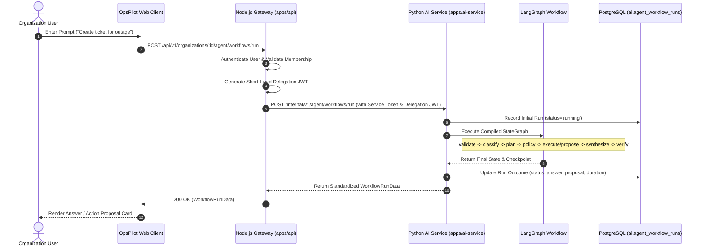

# Agent Workflow Design & Execution Lifecycle

## Overview

The OpsPilot AI agent workflow engine coordinates multi-step operational tasks by transforming natural language user queries into validated, policy-compliant actions.

The lifecycle bridges the **Node.js Express API** (which acts as the identity, authorization, and tenant authority) and the **Python AI Service** (which hosts LangGraph workflow execution, LLM reasoning, and vector retrieval).

---

## Workflow Execution Steps

### 1. User Request & Express Gateway Validation

- The frontend client sends `POST /api/v1/organizations/:organizationId/agent/workflows/run` with the query string and optional `threadId` and `correlationId`.
- The Express gateway checks:
  1. `requireAuthentication`: Ensures the user is logged in with a valid JWT access token.
  2. `requireOrganizationContext`: Verifies active tenant membership and extracts the user's role (`owner`, `admin`, `member`, `viewer`).
  3. `runWorkflowSchema`: Validates query length (1–5000 chars) and sanitizes input.

### 2. Delegation Token Issuance

- The Express service creates a short-lived (15-minute) JWT assertion signed with `JWT_ACCESS_SECRET`.
- Scopes are restricted based on the caller's role:
  - `viewer`: Read-only scopes (`tools:read`, `tickets:read`, `users:read`, `documents:read`, `knowledge:read`).
  - `member`, `admin`, `owner`: Full operational scopes (including `tickets:write`).
- Contains claims: `sub` (userId), `orgId` (organizationId), `requestId` (UUID), `scopes` (string array).

### 3. Python Service Invocation

- The Express gateway invokes `POST /internal/v1/agent/workflows/run` on the Python AI service.
- The request passes `X-Internal-Service-Token` and the serialized `RunWorkflowRequest`.
- The Python service verifies the internal token, instantiates an immutable `WorkflowContext`, and generates a unique `run_id`.

### 4. Graph Invocation & Policy Verification

- The graph initializes with `OpsPilotWorkflowState`.
- Nodes execute sequentially:
  - `validate_input`: Enforces input safety.
  - `classify_intent`: Determines intent category via structured LLM schema.
  - `create_plan`: Selects tool arguments and identifies whether the operation is read-only or proposal-only.
  - `policy_check`: Compares required scopes against `WorkflowContext.permitted_scopes`. If unauthorized, routes directly to `generate_response` with `policy_blocked=True`.

### 5. Conditional Execution & Response Generation

- If approved, routes to the appropriate execution node:
  - `knowledge_retrieval`: Returns grounded document snippets and filenames.
  - `execute_readonly_tool`: Invokes internal Node.js tool gateway and retrieves data.
  - `propose_mutation`: Generates an action proposal with risk level and approval requirement.
- `generate_response` formats the answer.
- `validate_response` checks citations against retrieved documents.

### 6. Persistence & Audit Recording

- The final state is checkpointed in PostgreSQL using `AsyncPostgresSaver`.
- `AgentWorkflowRunRepository` updates `ai.agent_workflow_runs` with outcome, duration, proposal ID, citations, and error code.
- Response is returned to the user client.
