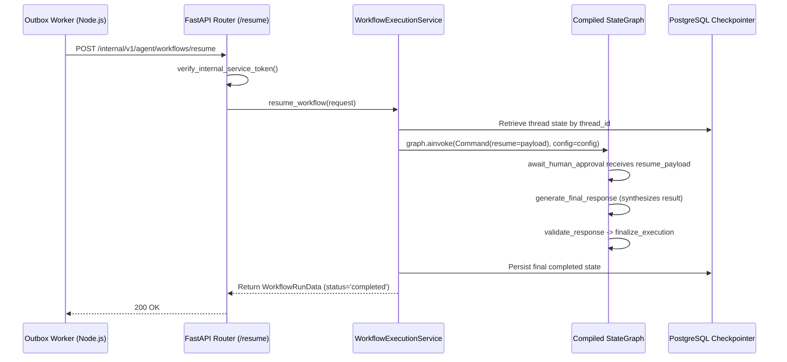

# LangGraph Interruption & Workflow Resumption

## 1. LangGraph Interruption Mechanism

In LangGraph v0.2+, human-in-the-loop workflows rely on native checkpointing and the `interrupt()` construct. When an agent action proposal is generated during multi-step execution:

1. The validation edge (`route_after_validation`) detects `requires_approval=True` and redirects to the `await_human_approval` node.
2. Inside `await_human_approval`, `interrupt(payload)` is invoked:
   ```python
   resume_payload = interrupt({
       "status": "awaiting_approval",
       "proposal_id": proposal_id,
       "tool_name": tool_name,
       "proposed_action": proposed_action,
       "risk_level": risk_level,
   })
   ```
3. LangGraph immediately suspends graph traversal, saves the complete thread state into the PostgreSQL checkpointer (`ai.checkpoints`), and surfaces the interrupt payload in the initial `ainvoke()` response.
4. The workflow run record in `ai.workflow_runs` is marked with `status='awaiting_approval'` and `requires_approval=True`.

---

## 2. Resumption via Command(resume=...)

When an approval or rejection event occurs, the Node.js background outbox worker dispatches an authenticated HTTP POST request to:
`POST /internal/v1/agent/workflows/resume`

```json
{
  "thread_id": "thread-999",
  "proposal_id": "prop-exec-1",
  "decision": "approved",
  "decided_by": "22222222-2222-4222-8222-222222222222",
  "decision_reason": "Verified and authorized",
  "execution_result": {
    "ticket_id": "ticket-uuid-777",
    "ticket_number": 2048,
    "subject": "Database Failover",
    "status": "open"
  }
}
```

### Execution Flow in Python Service



### Response Synthesis Upon Resumption

* **When Approved:**
  The `generate_final_response` node incorporates the executed business entity details:
  > *"The proposed action has been approved and executed successfully. Target entity: Ticket #2048."*
  The workflow run status is updated to `completed`.
* **When Rejected:**
  The node synthesizes the human reviewer's rejection reason:
  > *"The proposed operational action was rejected by human operator. Reason: Post-incident verification not yet signed off."*
  The workflow run status is updated to `rejected`.

---

## 3. Context & Checkpointer Preservation

Because thread checkpoints are keyed by `thread_id` in PostgreSQL:
* All previously gathered RAG passages, tool outputs, and conversational context remain intact across indefinite suspension periods (hours or days).
* The agent does not re-plan or re-execute previously completed steps upon wakeup; it resumes directly at the interrupt boundary.
