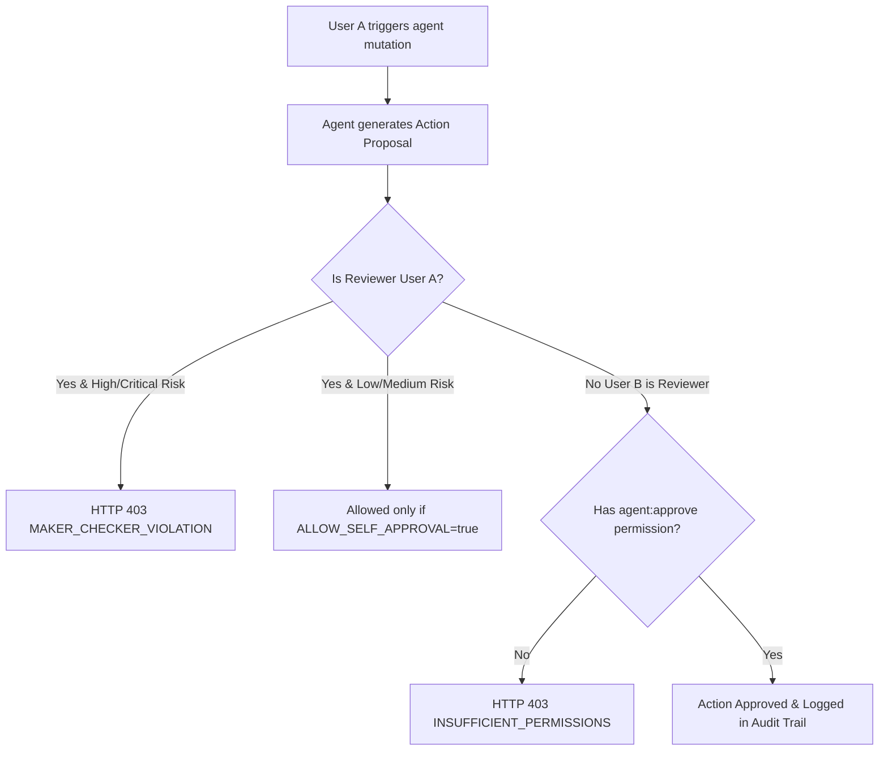

# Approval Security & Maker-Checker Policies

## 1. The Maker-Checker Security Pattern

In enterprise environments, the **Maker-Checker** (or Four-Eyes) principle mandates that no critical or high-risk operational modification can be approved by the same principal who initiated it.

OpsPilot AI strictly implements this control:
* **The Maker:** The user who prompted the agent or whose session triggered the workflow proposal (`requested_by`).
* **The Checker:** An independent human administrator who reviews the proposal diff, evaluates operational impact, and authorizes execution (`decided_by`).

---

## 2. Risk Level Matrix & Policy Defaults

Every agent action proposal is categorized into a risk tier:

| Risk Tier | Examples | Self-Approval Permitted? | Required Role | Mandatory Review Notes |
| :--- | :--- | :--- | :--- | :--- |
| **Low** | Read-only tagging, ticket categorisation suggestion | Yes (if enabled via config) | `owner`, `admin` | Optional |
| **Medium** | Reassigning low-severity ticket, drafting responses | Configurable (`ALLOW_SELF_APPROVAL`) | `owner`, `admin` | Optional |
| **High** | Creating new support ticket, modifying priority | **Strictly Forbidden (403)** | `owner`, `admin` | Optional |
| **Critical** | Closing customer tickets, bulk reassignment | **Strictly Forbidden (403)** | `owner`, `admin` | Highly Recommended |

### Policy Configuration

Environment variables configure organization-wide policy behavior:
* `AGENT_ALLOW_SELF_APPROVAL`: `false` by default. When `false`, even low-risk proposals require an independent checker.
* `AGENT_MAX_PENDING_PROPOSALS`: Maximum outstanding proposals per organization before throttling agent mutation generation.
* `AGENT_PROPOSAL_TTL_HOURS`: Proposal expiration window (default: `24` hours). Expired proposals cannot be approved.

---

## 3. RBAC & Organization Scopes

1. **Permission Definition:**
   * A dedicated granular permission `'agent:approve'` is introduced in Module 14.
   * By default, `'agent:approve'` is granted to `owner` and `admin` roles, and withheld from regular `member` and `viewer` roles.
2. **Delegation Token Verification:**
   * Internal tool calls pass a short-lived cryptographic assertion token (`x-delegation-token`).
   * The Node.js tool gateway verifies that the requesting user's identity is pinned to the generated proposal in `requested_by`.
3. **Audit Trail Immutability:**
   * Once recorded in `app.agent_action_approvals`, decisions cannot be altered or removed.
   * Timestamps, IP addresses, decider user IDs, and policy snapshots are frozen for compliance auditing (SOC 2, ISO 27001).
