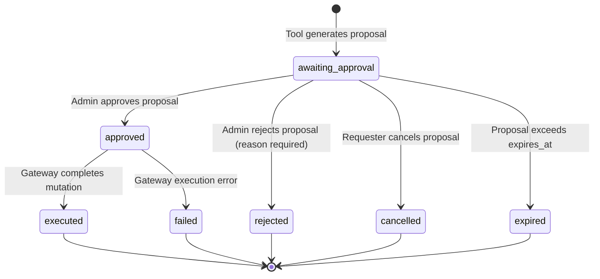

# Agent Action Approval Workflow & Lifecycle

## 1. Action Proposal Lifecycle States

Each operational action proposal moves through deterministic lifecycle states tracked in `app.agent_action_proposals`:



### State Definitions

| State | Description | Permitted Transitions |
| :--- | :--- | :--- |
| `awaiting_approval` | Initial state. The proposal is awaiting human review. The LangGraph thread is suspended at `interrupt()`. | `approved`, `rejected`, `cancelled`, `expired` |
| `approved` | Authorized reviewer recorded an affirmative decision. An outbox event is created for asynchronous execution. | `executed`, `failed` |
| `rejected` | Reviewer explicitly rejected the proposed action with a mandatory justification. | Terminal |
| `cancelled` | The requesting user retracted the pending proposal before review. | Terminal |
| `executed` | The Node.js execution gateway successfully applied the mutation via Module 05 business services. | Terminal |
| `failed` | The execution gateway encountered a terminal business or system error during mutation. | Terminal |

---

## 2. API Surface

All public approval endpoints require JWT authentication, organization context middleware (`x-organization-id`), and appropriate role permissions.

### List Action Proposals
* **Endpoint:** `GET /api/v1/organizations/:organizationId/agent/approvals`
* **Query Parameters:**
  * `status`: Filter by `awaiting_approval`, `approved`, `rejected`, `executed`, `failed`, `cancelled`.
  * `riskLevel`: Filter by `low`, `medium`, `high`, `critical`.
  * `page`: Page index (default: `1`).
  * `limit`: Items per page (default: `20`, max: `100`).

### Get Proposal Audit Record
* **Endpoint:** `GET /api/v1/organizations/:organizationId/agent/approvals/:proposalId`
* **Response:** Returns comprehensive proposal metadata, parameters, policy snapshot, approval decision details, and execution result.

### Approve Action Proposal
* **Endpoint:** `POST /api/v1/organizations/:organizationId/agent/approvals/:proposalId/approve`
* **Required Permission:** `agent:approve` (Owner and Admin roles)
* **Payload:**
  ```json
  {
    "notes": "Verified with infrastructure team lead."
  }
  ```
* **Enforcement:** Enforces Maker-Checker policy. If the reviewer is the requester and the proposal is `high` or `critical` risk, returns HTTP 403 `MAKER_CHECKER_VIOLATION`.

### Reject Action Proposal
* **Endpoint:** `POST /api/v1/organizations/:organizationId/agent/approvals/:proposalId/reject`
* **Required Permission:** `agent:approve` (Owner and Admin roles)
* **Payload:**
  ```json
  {
    "reason": "Customer SLA dispute requires manual handling."
  }
  ```

### Cancel Action Proposal
* **Endpoint:** `POST /api/v1/organizations/:organizationId/agent/approvals/:proposalId/cancel`
* **Access:** Requester or organization admin.
* **Payload:** Optional cancellation reason.

---

## 3. Transactional Outbox Pattern

To prevent distributed transaction failures between PostgreSQL mutations and remote AI service resumption, the system implements a transactional outbox table: `app.agent_workflow_outbox`.

When an approval or rejection is committed:
1. The proposal status update and the outbox event are inserted atomically inside a single PostgreSQL database transaction.
2. The background worker (`agent-approval-outbox.worker.ts`) polls pending outbox entries using `FOR UPDATE SKIP LOCKED`.
3. If approved, the worker calls the idempotent execution gateway.
4. The worker dispatches an internal resumption HTTP call to the Python AI service.
5. Upon successful acknowledgment, the outbox record is marked completed.
6. If the AI service is unreachable, exponential backoff retries preserve the message without dropping state.
