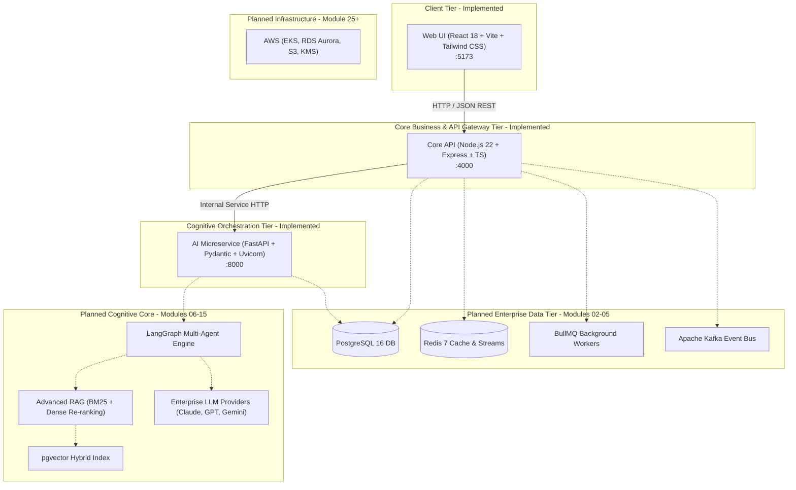
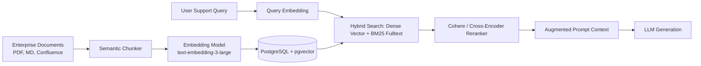
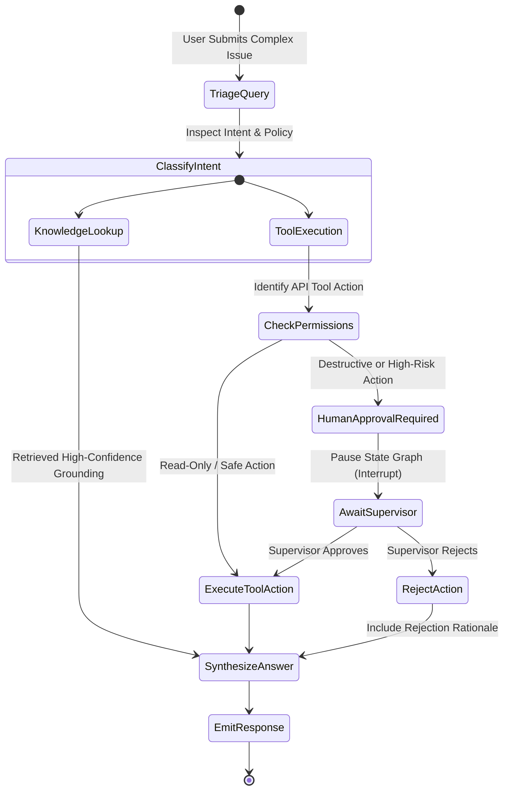
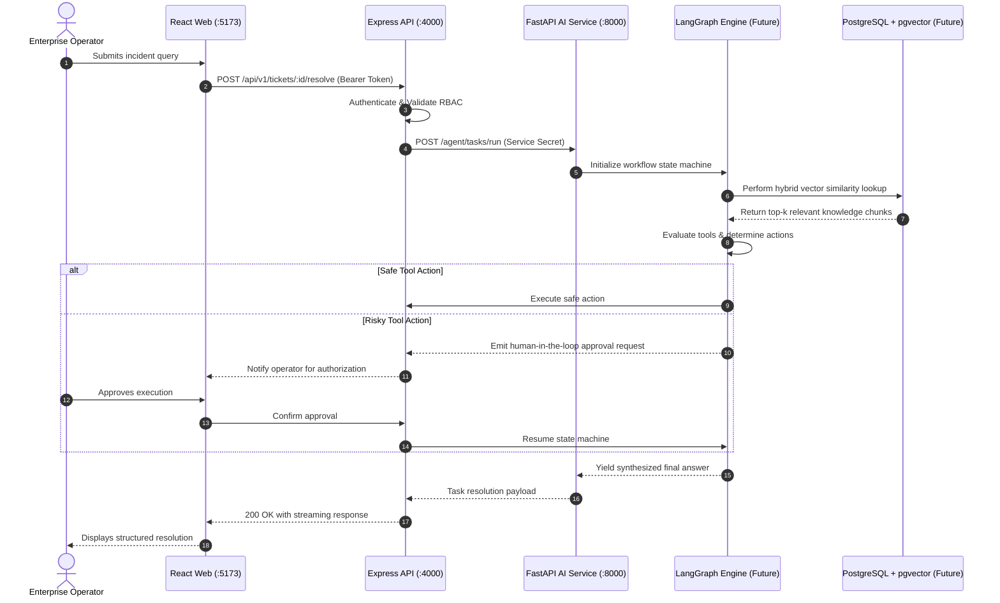

# OpsPilot AI — Enterprise System Architecture

## 1. Project Introduction

OpsPilot AI is an enterprise-grade Agentic AI platform engineered for mission-critical IT operations, customer support automation, and organizational knowledge orchestration.

Modern enterprise support operations face acute challenges: fragmented documentation across disparate systems, repetitive Tier-1/Tier-2 incidents, sluggish MTTR (Mean Time to Resolution), and manual triaging bottlenecks. OpsPilot AI bridges the divide between human operators and cognitive automation through an autonomous, multi-tier agentic architecture designed for high throughput, verifiable safety, and auditable governance.

---

## 2. System Overview

OpsPilot AI adopts a polyglot microservice monorepo architecture that strategically pairs the strengths of Node.js for high-concurrency API and business orchestration with Python for machine learning and agentic graph workflows.

---

## 3. Frontend Architecture (`@opspilot/web`)

The frontend is a modern single-page application (SPA) optimized for ultra-low latency interaction and state synchronization:

- **Framework**: React 18 with TypeScript in strict mode.
- **Build System**: Vite 6 delivering sub-second HMR and optimized ESM tree-shaken production bundles.
- **Styling**: Tailwind CSS with an enterprise design token hierarchy ensuring high-density data legibility and dark/light system adaptation.
- **Client State Management**:
  - **Zustand**: Lightweight, decoupled store for local application state, user preferences, and UI toggles.
  - **TanStack Query (React Query v5)**: Declarative server-state caching, automatic background revalidation, and mutation lifecycles.
- **Networking**: Axios instance pre-configured with request/response interceptors, automatic CSRF handling, and standardized error normalization.
- **Routing**: React Router DOM v6 with declarative nested layout boundaries and lazy-loaded route splits.

---

## 4. Core Backend Architecture (`@opspilot/api`)

The primary backend service provides enterprise business logic encapsulation, tenant isolation, and API gateway capabilities:

- **Runtime**: Node.js 22 (LTS) providing high-throughput non-blocking asynchronous I/O.
- **Web Layer**: Express.js configured through a strict separation of concerns (`app.ts` configuration separated cleanly from `server.ts` lifecycle management).
- **Configuration & Validation**: Zod runtime schema validation strictly validating environment variables on startup. The process terminates immediately with structured diagnostics if configuration is malformed.
- **Defensive Security**:
  - `helmet`: Applies industry-standard HTTP security headers (CSP, HSTS, X-Content-Type-Options).
  - `cors`: Strict origin whitelisting allowing only authorized client origins.
- **Error Handling**: Centralized middleware capturing operational errors vs programmer defects, preventing stack trace leakage in non-development environments.
- **Resilience**: Graceful shutdown handles `SIGINT`/`SIGTERM` signals, completing in-flight requests before cleanly closing socket listeners.

---

## 5. AI Microservice Architecture (`opspilot-ai-service`)

The AI service serves as the dedicated cognitive computing engine:

- **Runtime**: Python 3.11+ leveraging modern typing and async concurrency features.
- **Framework**: FastAPI with asynchronous route handlers (`async def`).
- **Server**: Uvicorn ASGI server providing industrial-grade event loop performance.
- **Validation**: Pydantic v2 schemas and Pydantic Settings for strictly typed configuration models.
- **Tooling**: Packaged and managed with Astral `uv` for deterministic, ultra-fast dependency resolution.
- **Observability**: Structured Python logging configured for container ingestion.

---

## 6. Service Responsibilities

| Responsibility Domain         | Node.js Core API (`apps/api`)              | Python AI Service (`apps/ai-service`)  | React Web (`apps/web`)                  |
| :---------------------------- | :----------------------------------------- | :------------------------------------- | :-------------------------------------- |
| **Authentication & RBAC**     | Primary Owner (JWT, sessions, permissions) | Consumer (validates token context)     | Presentation (tokens, protected routes) |
| **Data CRUD & Multi-Tenancy** | Primary Owner (PostgreSQL relational data) | Read-only / Vector projection          | Render views and data grids             |
| **Job Queue Management**      | Primary Owner (BullMQ, scheduling)         | Worker consumer for heavy inference    | Job progress indicator                  |
| **LLM & Agent Workflows**     | Triggers asynchronous runs                 | Primary Owner (LangGraph state engine) | Streaming output display                |
| **Vector Indexing & Search**  | Emits ingestion events                     | Primary Owner (Embeddings, RAG search) | Search input and results                |
| **Audit & Governance**        | Primary Owner (Audit trails, compliance)   | Internal step-level trajectory logs    | Audit visualization                     |

---

## 7. Communication Between Services

1. **Client to Backend**: JSON over HTTPS / WebSockets (Module 07) via `/api/v1/*`.
2. **Backend to AI Microservice**: Internal microservice HTTP/REST (Module 01) transitioning to mutual-TLS gRPC or internal message queues (Module 18) for streaming generation.
3. **Asynchronous Task Offloading**: High-latency agent executions will be dispatched via Redis/BullMQ to prevent blocking HTTP threads.

---

## 8. Proposed Future Database Layer (Module 02+)

- **Relational Storage**: PostgreSQL 16 serving as the single source of truth for accounts, organizations, tickets, audit logs, and workflow states.
- **Vector Storage**: `pgvector` extension integrated directly inside PostgreSQL, eliminating multi-database synchronization overhead and enabling transactional consistency between documents and vector embeddings.
- **Caching & Ephemeral State**: Redis 7 utilized for distributed session storage, rate limiting buckets, and Pub/Sub event broadcasting.

---

## 9. Proposed Future RAG Architecture (Module 06)

---

## 10. Proposed Future Agentic AI Workflow (Module 10)

Future agentic interactions will be governed by LangGraph state machines:

---

## 11. Security Boundaries

1. **Perimeter Defense**: React web application operates in an untrusted browser environment. No secret keys or database credentials exist on the client.
2. **API Isolation**: All external requests must traverse Node.js Express API where authentication, rate limiting, and RBAC policies are enforced.
3. **Internal AI Boundary**: Python AI microservice will reside in a private internal subnet, reachable exclusively by the Core API.
4. **Environment Isolation**: Strict `.env` parsing ensures fail-fast validation before network sockets bind.

---

## 12. Request Lifecycle Flowchart

The following diagram illustrates how user requests travel through the target system architecture:

