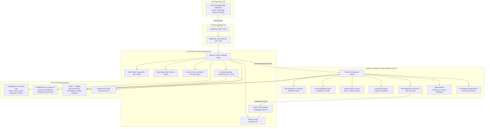

# OpsPilot AI — System Architecture Blueprint

## 1. Executive Architecture Summary

OpsPilot AI is an enterprise-grade multi-tenant Agentic AI and Autonomous Support Operations platform. Engineered for mission-critical IT, DevOps, and customer support environments, the platform enables organizations to ingest confidential corporate knowledge, perform hybrid RAG retrieval, automate multi-step diagnostic investigations, and execute authorized business mutations via autonomous LangGraph agents while strictly enforcing human-in-the-loop maker-checker approval controls.



---

## 2. Core Service Boundaries & Responsibilities

### 2.1 Web Application (`apps/web`)
- **Technology**: React 18, TypeScript 5, Vite 6, Tailwind CSS, TanStack Query v5, Zustand v5, React Router v6.
- **Responsibilities**:
  - Responsive, accessible enterprise UI shell with dark/light theme support.
  - Multi-tenant organization switching and workspace context management.
  - Dynamic route-level code splitting using `React.lazy` and `Suspense` (initial JS bundle: 453 kB).
  - RBAC view gating (`viewer`, `member`, `agent`, `admin`, `owner`).
  - Real-time agent approval cards with diff views and maker-checker validation warnings.
  - Streaming AI chat interface with interactive citations and document preview pills.
  - Interactive Agent Monitoring and AI Evaluation dashboards.
- **Invariants**:
  - Never connects directly to PostgreSQL or Redis.
  - Never accesses the internal Python AI microservice directly.
  - Stores no credentials or sensitive tokens in `localStorage`.

### 2.2 Core Node.js API Gateway (`apps/api`)
- **Technology**: Node.js 22, Express 4, TypeScript 5, node-pg-migrate, BullMQ.
- **Responsibilities**:
  - User identity, authentication, session rotation, and OWASP-compliant password security.
  - Organization multi-tenancy, member invitations, and tenant boundary enforcement.
  - Support ticket CRUD, status lifecycle transitions, and ticket numbering sequences.
  - Document upload authorization, mime validation, and file persistence via `IStorageProvider`.
  - Internal Tool Gateway with cryptographic tool delegation tokens and scope checks.
  - Human-in-the-Loop approval workflows, outbox queues, and maker-checker segregation.
  - Tiered rate limiting (global, AI operations, file uploads) and secret masking.
- **Schema Ownership**: Exclusively owns and migrates the PostgreSQL `app` schema.

### 2.3 Cognitive AI Microservice (`apps/ai-service`)
- **Technology**: Python 3.11, FastAPI, Pydantic v2, SQLAlchemy 2 (asyncpg), Alembic, LangGraph.
- **Responsibilities**:
  - Multi-format document text extraction (PDF, DOCX, TXT) and deterministic chunking.
  - OpenAI vector embeddings generation and batch queue processing.
  - Hybrid RAG search combining cosine similarity (`pgvector`) with full-text search (`tsvector`).
  - LangGraph stateful multi-step cognitive agent workflows with interruptible checkpoints.
  - Ephemeral and persistent agent memory with user consent screening.
  - AI quality evaluation (faithfulness, answer relevance, context recall, tool selection).
  - SSRF protection against cloud metadata and loopback IP addresses.
- **Schema Ownership**: Exclusively owns and migrates the PostgreSQL `ai` schema.

---

## 3. Data Ownership & Tenant Isolation Model

```
PostgreSQL Database: opspilot_db
│
├── Schema: app (Owner: opspilot_api)
│   ├── users
│   ├── user_sessions
│   ├── password_reset_tokens
│   ├── email_verification_tokens
│   ├── auth_audit_logs
│   ├── organizations
│   ├── organization_members
│   ├── organization_invitations
│   ├── tickets
│   ├── ticket_comments
│   ├── ticket_events
│   ├── ticket_counters
│   ├── documents
│   ├── document_audit_logs
│   ├── agent_action_proposals
│   ├── agent_action_approvals
│   ├── agent_action_executions
│   └── agent_workflow_outbox
│
└── Schema: ai (Owner: opspilot_ai)
    ├── document_processing_jobs
    ├── document_chunks (embedding vector(1536), tsv tsvector)
    ├── langgraph_checkpoints
    ├── langgraph_checkpoint_writes
    ├── user_memories
    ├── memory_audit_logs
    ├── evaluation_datasets
    ├── evaluation_runs
    └── evaluation_results
```

### Invariants:
1. **Row-Level Tenant Isolation**: Every entity (except global users) contains a mandatory `organization_id` foreign key.
2. **Schema Separation**: `opspilot_api` has zero privileges on schema `ai`; `opspilot_ai` has zero privileges on schema `app`.
3. **Database Migration Safety**: Migrations for `app` (`node-pg-migrate`) and `ai` (`alembic`) execute in isolated database roles.
