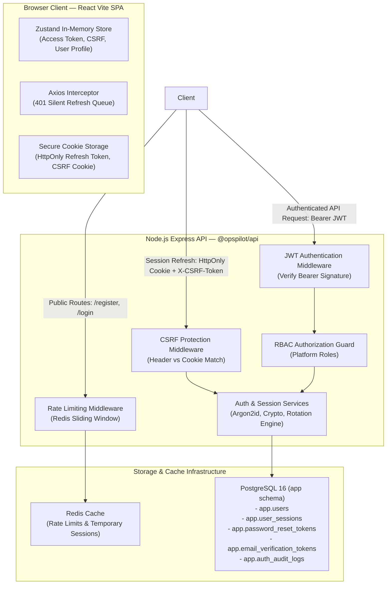
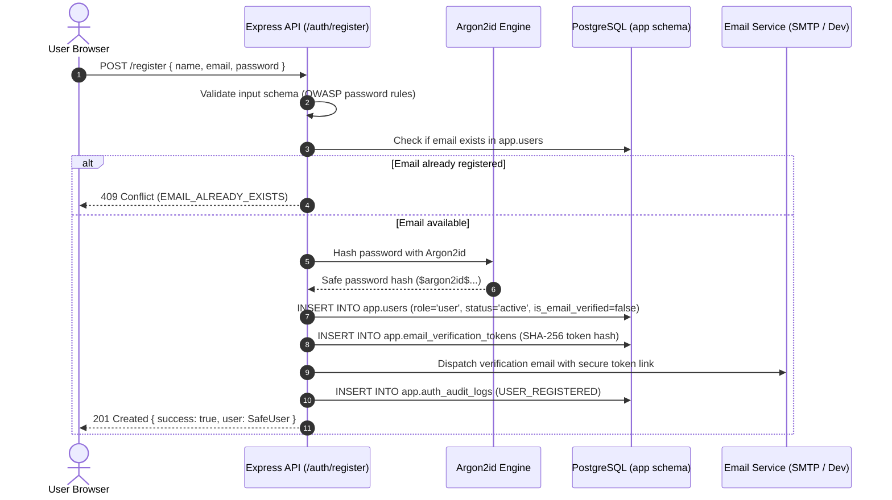
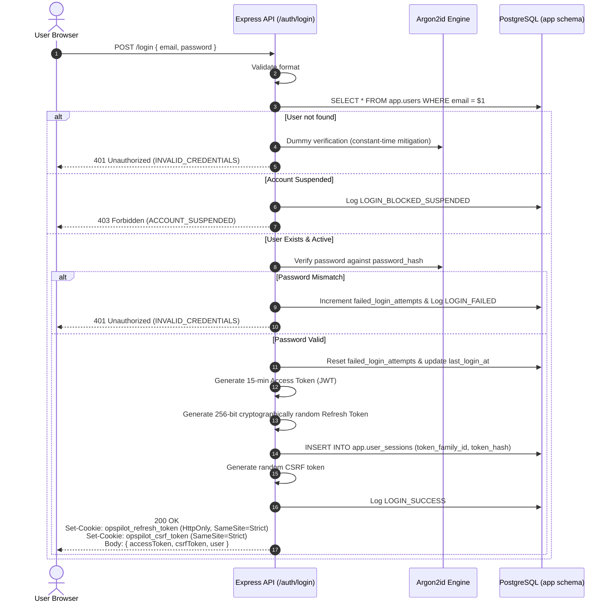
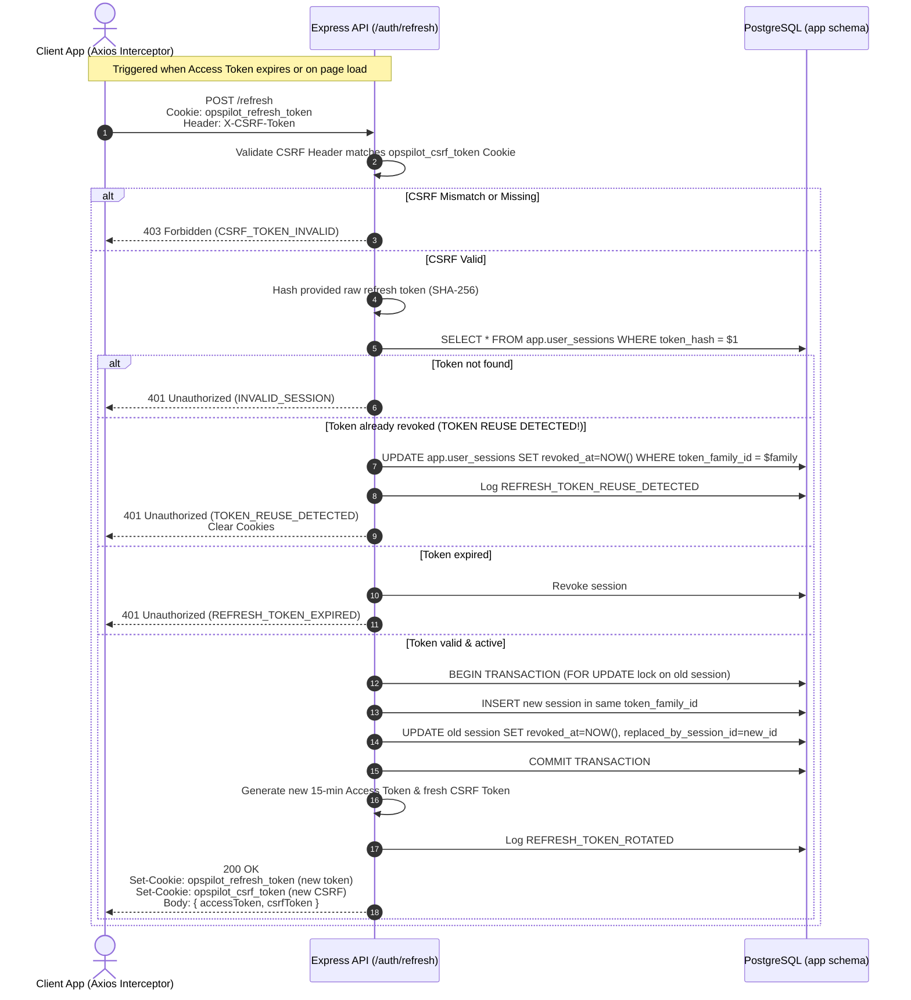
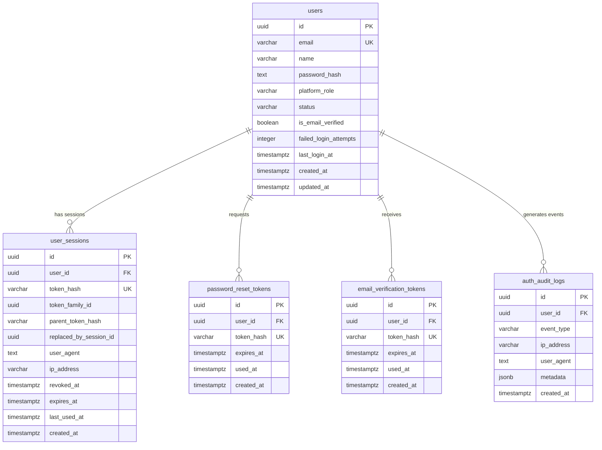

# OpsPilot AI — Authentication & Authorization Architecture

## 1. Architectural Overview & Design Philosophy

OpsPilot AI enforces a zero-trust, defense-in-depth authentication and session management architecture designed for enterprise-grade Agentic AI operations.

### Key Architectural Tenets

1. **Node.js Express as Sole Identity Authority**: The Node.js Express API (`@opspilot/api`) maintains exclusive ownership of identity, credential verification, platform authorization, and the PostgreSQL `app` schema. The Python FastAPI AI microservice never authenticates end-users directly.
2. **Ephemeral In-Memory Access Tokens**: 15-minute JWT access tokens are maintained strictly in application memory (Zustand store / React context). They are **never** persisted to `localStorage`, `sessionStorage`, or IndexedDB to prevent XSS-based credential exfiltration.
3. **Cryptographically Rotated HttpOnly Refresh Tokens**: Long-lived refresh sessions (7 days) use random 256-bit entropy tokens stored exclusively in secure `HttpOnly`, `SameSite=Strict` cookies scoped to `/api/v1/auth`.
4. **Token Family Tracking & Active Reuse Detection**: Every refresh operation rotates the token inside an atomic PostgreSQL transaction. Replay of spent tokens triggers immediate family-wide revocation, neutralizing token interception and replay attacks.
5. **Double-Submit CSRF Header Validation**: State-changing cookie-authenticated endpoints (`/refresh`, `/logout`, `/logout-all`) mandate the presence of a matching `X-CSRF-Token` HTTP header against a client-readable CSRF cookie.
6. **State-of-the-Art Password Hashing**: Passwords are encrypted using **Argon2id** (memory cost $19\text{ MiB}$, time cost $2$ iterations, $1$ thread parallelism) to withstand GPU and ASIC offline dictionary attacks.

---

## 2. High-Level Architecture



---

## 3. Cryptographic Token Lifecycle & Flows

### 3.1 User Registration Flow



### 3.2 User Login Flow



### 3.3 Silent Token Refresh & Atomic Rotation Flow



---

## 4. Database Relational Model

All authentication tables reside within the `app` schema:



---

## 5. Platform Roles & RBAC Foundations

OpsPilot AI establishes a strict two-tier platform role architecture in Module 03:

| Role Name            | Intended Audience            | Permissions & Privileges                                                                       | Escalation Protection                                                |
| :------------------- | :--------------------------- | :--------------------------------------------------------------------------------------------- | :------------------------------------------------------------------- |
| **`user`**           | Standard platform operators  | Access own profile, tickets, workspaces, execution history. Cannot access platform admin APIs. | Default assigned to all public registrations.                        |
| **`platform_admin`** | System infrastructure owners | Access platform administration, user management, audit logs, cluster metrics.                  | Cannot be granted via registration API; requires CLI bootstrap tool. |

### Role Authorization Middleware

```typescript
// Enforce minimum platform role
export const requirePlatformRole = (...allowedRoles: PlatformRole[]) => {
  return (req: Request, res: Response, next: NextFunction): void => {
    if (!req.user) {
      res.status(401).json({ success: false, error: { code: 'UNAUTHORIZED' } });
      return;
    }
    if (!allowedRoles.includes(req.user.role)) {
      res.status(403).json({ success: false, error: { code: 'FORBIDDEN' } });
      return;
    }
    next();
  };
};
```

---

## 6. Audit Logging & Non-Repudiation

Every security-sensitive event is recorded synchronously in `app.auth_audit_logs`:

- `USER_REGISTERED`
- `LOGIN_SUCCESS`, `LOGIN_FAILED`, `LOGIN_BLOCKED_SUSPENDED`
- `REFRESH_TOKEN_ROTATED`, `REFRESH_TOKEN_REUSE_DETECTED`
- `SESSION_REVOKED`, `ALL_SESSIONS_REVOKED`
- `PASSWORD_RESET_REQUESTED`, `PASSWORD_RESET_SUCCESS`
- `EMAIL_VERIFICATION_SENT`, `EMAIL_VERIFIED`

Audit logs preserve the client IP address, User-Agent header, subject UUID, and structured metadata without ever recording raw tokens or sensitive passwords.
