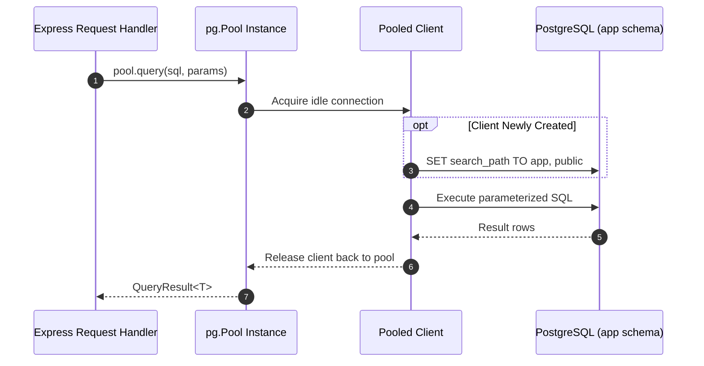
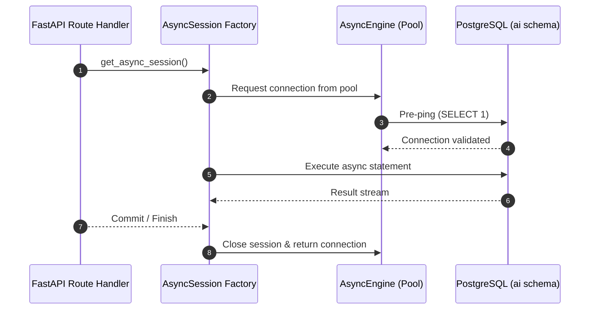

# OpsPilot AI — Database Architecture & Schema Ownership

## 1. Overview & Architectural Philosophy

OpsPilot AI uses **PostgreSQL 16** with the **`pgvector`** extension as the unified relational and high-dimensional vector storage engine.

To support both enterprise business operations (users, organizations, tickets, approvals) and cognitive AI workflows (vector embeddings, document chunks, agent state checkpoints) without architectural coupling or privilege cross-contamination, OpsPilot AI enforces **Strict Dual-Schema Partitioning**:

```mermaid
graph TD
    subgraph Client Application Tier
        NodeAPI["Node.js Express API (@opspilot/api)<br/>Role: opspilot_api"]
        PythonAI["Python FastAPI Service (opspilot-ai-service)<br/>Role: opspilot_ai"]
    end

    subgraph PostgreSQL Cluster [PostgreSQL 16 Database: opspilot_db]
        subgraph Schema App [Schema: app]
            AppTables["Business Data (Modules 03+)<br/>- Users & Auth<br/>- Organizations<br/>- Support Tickets<br/>- Approvals & Audit"]
        end

        subgraph Schema AI [Schema: ai]
            AITables["Cognitive Data (Modules 06+)<br/>- Document Chunks<br/>- Vector Embeddings<br/>- LangGraph State Checkpoints<br/>- Episodic Agent Memory"]
        end

        subgraph Public Schema [Schema: public]
            VectorExt["pgvector Extension<br/>(vector type & distance operators)"]
        end
    end

    NodeAPI -->|Pool Connection| Schema App
    PythonAI -->|Async Connection| Schema AI
    Schema AI -.->|Vector Calculations| VectorExt
    Schema App -.->|Vector Queries| VectorExt

    %% Strict Boundaries
    NodeAPI -.->|ACCESS DENIED| Schema AI
    PythonAI -.->|ACCESS DENIED| Schema App
```

---

## 2. PostgreSQL Roles & Least Privilege Enforcement

Three distinct database roles are established:

| Role Name            | Scope               | Permissions & Grants                                                                          | Superuser?         |
| :------------------- | :------------------ | :-------------------------------------------------------------------------------------------- | :----------------- |
| **`opspilot_admin`** | Infrastructure Init | Used only by Docker entrypoint for database creation, role provisioning, and extension setup. | Yes (`SUPERUSER`)  |
| **`opspilot_api`**   | Node.js Backend     | Owner of `app` schema. Full CRUD on `app.*`. Denied access to `ai.*`.                         | No (`NOSUPERUSER`) |
| **`opspilot_ai`**    | Python Microservice | Owner of `ai` schema. Full CRUD on `ai.*`. Denied access to `app.*`.                          | No (`NOSUPERUSER`) |

### Security Boundaries

- **Cross-Schema Revocation**: `REVOKE ALL ON SCHEMA ai FROM opspilot_api;` and `REVOKE ALL ON SCHEMA app FROM opspilot_ai;`
- **Default Search Paths**:
  - `opspilot_api`: `SET search_path TO app, public;`
  - `opspilot_ai`: `SET search_path TO ai, public;`
- **Hardened Public Schema**: `REVOKE CREATE ON SCHEMA public FROM PUBLIC;` prevents unauthorized tables from leaking into the shared namespace.

---

## 3. High-Dimensional Vector Storage: `pgvector`

The official `pgvector/pgvector:pg16` image provides the `vector` extension.

- **Verification Query**:
  ```sql
  SELECT extname, extversion FROM pg_extension WHERE extname = 'vector';
  ```
- **Usage**: Enables dense semantic vector embeddings (`vector(1536)` or `vector(3072)`) alongside relational document metadata with HNSW or IVFFlat indexing for approximate nearest neighbor (ANN) search.

---

## 4. Node.js Connection Pooling Lifecycle (`apps/api`)

The Node.js backend uses `pg.Pool` with automated connection timeouts, idle reclamation, and credential masking:



### Connection Pool Configuration

```typescript
{
  max: config.DATABASE_POOL_MAX,                 // Default: 20
  idleTimeoutMillis: config.DATABASE_IDLE_TIMEOUT_MS, // Default: 30,000ms
  connectionTimeoutMillis: config.DATABASE_CONNECTION_TIMEOUT_MS // Default: 5,000ms
}
```

---

## 5. Python AI Service Async Engine Lifecycle (`apps/ai-service`)

The Python AI service uses SQLAlchemy 2.x with `asyncpg` and connection pre-ping:



### Engine Configuration

```python
create_async_engine(
    settings.AI_DATABASE_URL,
    pool_size=settings.DATABASE_POOL_SIZE,        # Default: 10
    max_overflow=settings.DATABASE_MAX_OVERFLOW,  # Default: 5
    pool_timeout=settings.DATABASE_POOL_TIMEOUT,  # Default: 30s
    pool_pre_ping=True,
    connect_args={"server_settings": {"search_path": "ai, public"}},
)
```
