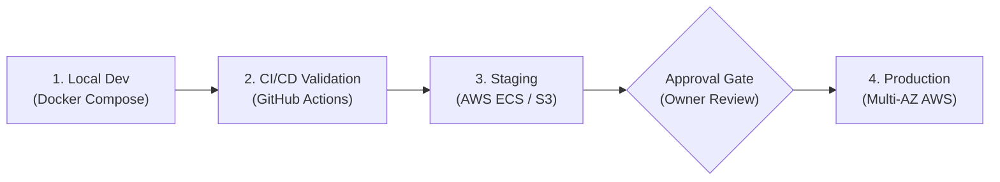

# OpsPilot AI — Deployment Guide: Local, CI/CD & AWS Cloud

This document explains the end-to-end deployment lifecycle for OpsPilot AI across local containers, automated continuous delivery pipelines, and AWS cloud environments.

---

## 1. Deployment Tiers



---

## 2. Tier 1: Local Docker Deployment

For development, testing, and isolated demonstrations:
```bash
# 1. Start database and cache infrastructure
npm run infra:up

# 2. Run migrations
npm run db:migrate

# 3. Build and launch applications
npm run dev
```

---

## 3. Tier 2: Automated CI/CD Pipelines

GitHub Actions workflows in `.github/workflows/` orchestrate testing, security, and packaging:
1. **`ci.yml`**: Triggers on pull requests and merges to `main`.
   - Runs ESLint and TypeScript typechecking across `@opspilot/web` and `@opspilot/api`.
   - Executes all 509 tests (Vitest + Pytest) with PostgreSQL 16 (`pgvector`) and Redis 7 service containers.
   - Validates bidirectional migrations (`node-pg-migrate` up/down and Alembic upgrade/downgrade).
   - Confirms production bundle compilation.
2. **`security.yml`**: Scheduled weekly and on PRs.
   - Runs `npm audit` and `pip-audit`.
   - Scans for leaked keys, tokens, or private credentials.
3. **`docker-build.yml`**: Validates multi-stage Docker builds across all 3 applications.
4. **`cd.yml`**: Release packaging on version tags (`v*.*.*`) or manual dispatch.
   - Publishes tagged container images to GitHub Container Registry (`ghcr.io`).
   - Uses GitHub Actions OIDC federation to assume an AWS IAM role and deploy to ECS/S3 without static AWS credentials.

---

## 4. Tier 3: AWS Cloud Deployment with Terraform

### Step 1: Remote State Bootstrap
Run once per AWS account:
```bash
cd infrastructure/terraform/bootstrap
terraform init
terraform apply
```

### Step 2: Staging Deployment
```bash
cd infrastructure/terraform/environments/staging
cp terraform.tfvars.example terraform.tfvars
# Update terraform.tfvars with actual parameters

terraform init
terraform plan -out=staging.tfplan

# Apply requires explicit approval:
terraform apply staging.tfplan
```

### Step 3: Production Deployment
```bash
cd infrastructure/terraform/environments/production
cp terraform.tfvars.example terraform.tfvars
# Populate with production parameters

terraform init
terraform plan -out=prod.tfplan

# Apply requires explicit authorization:
terraform apply prod.tfplan
```

---

## 5. Deployment Verification & Smoke Testing

After applying Terraform and publishing container images:
1. Verify API liveness: `curl -f https://<ALB_DNS_NAME>/health/live`
2. Verify API readiness: `curl -f https://<ALB_DNS_NAME>/health/ready`
3. Verify CloudFront frontend: Open `https://<CLOUDFRONT_DOMAIN>` in browser.
4. Login with platform credentials and verify organization switching, tickets, chat, and knowledge base.
