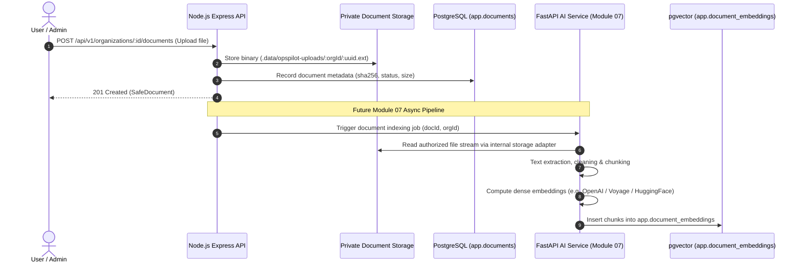

# Document Management & RAG Pipeline Integration (Module 07 Preview)

## 1. Architectural Hand-Off

Module 06 establishes the authorized file storage and metadata infrastructure. In Module 07 (RAG & Knowledge Search), the Python FastAPI AI service and LangGraph workflows will consume documents validated and stored by Module 06.

## 2. Integration Contract

## 3. Preparation Highlights for Module 07

1. **SHA-256 Checksums**: Pre-computed for every document in Module 06, enabling Module 07 to detect duplicates and invalidate vector caches when documents change.
2. **Immutable File Formats**: Standardized `.pdf`, `.docx`, `.txt`, `.md` formats allow PyMuPDF, `python-docx`, and UTF-8 parsers in FastAPI to run without unknown binary failures.
3. **Multi-Tenant Chunk Partitioning**: Every chunk in `app.document_embeddings` will carry `organization_id` and `document_id` foreign keys, enforcing identical Zero-Trust isolation during vector similarity searches (`cosine`, `inner product`).
