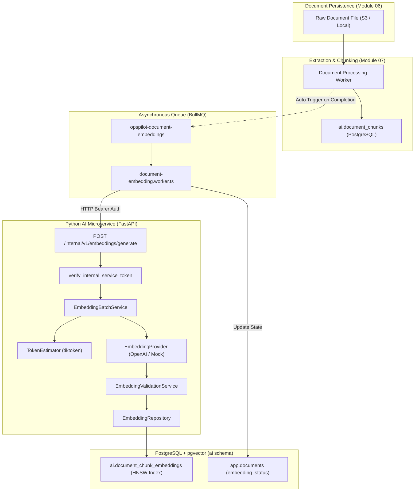

# OpsPilot AI – Embedding Generation Architecture

## 1. Architectural Overview

Module 08 establishes the vector embeddings subsystem for the OpsPilot AI platform. Building on top of the document processing pipeline (Module 07), the embedding subsystem transforms textual chunks into dense numerical vectors suitable for downstream semantic similarity search and Retrieval-Augmented Generation (RAG).

## 2. Core Architectural Principles

1. **Separation of Concerns & Schema Ownership**:
   - `app` schema: Owned by Node.js API (`app.documents` tracking metadata, `embedding_status`, `embedding_generation`, and `embedded_chunk_count`).
   - `ai` schema: Owned by Python FastAPI (`ai.document_chunks`, `ai.document_processing_runs`, `ai.document_chunk_embeddings`).
2. **Embedding Space Partitioning**:
   - Every embedding vector is partitioned by an explicit `embedding_space` string formatted as `{provider}:{model}:{dimensions}` (e.g. `openai:text-embedding-3-small:1536`).
   - Prevents cosine distance comparisons between disparate models or dimension truncations.
3. **Idempotency & Cost Optimization**:
   - Embedding generation is deterministic and keyed on `chunk_id` + `embedding_space`.
   - The repository performs hash-based deduplication: chunks whose content hash already exists for the target embedding space are skipped from remote provider API calls, eliminating duplicate vectorization costs.
4. **Resilient Background Execution**:
   - Dedicated BullMQ queue (`opspilot-document-embeddings`) with deterministic generation-aware job IDs (`document-${docId}-emb-gen-${embGen}`).
   - Stale job protection: Jobs carrying obsolete `embedding_generation` numbers are detected and discarded gracefully without overwriting newer state.
5. **pgvector HNSW Indexing**:
   - Uses Hierarchical Navigable Small World (`vector_cosine_ops`, `m = 16`, `ef_construction = 64`) for sub-millisecond approximate nearest neighbor (ANN) retrieval with zero external vector database dependencies.
