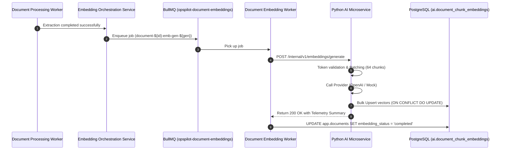

# OpsPilot AI – Embedding Pipeline Execution & Lifecycle

## 1. Automated Pipeline Triggering

When document extraction and chunking completes in Module 07 (`document-processing.handlers.ts`):

1. Document state transitions to `processing_status = 'completed'`.
2. The processing worker immediately invokes `documentEmbeddingOrchestrationService.triggerEmbeddingGeneration()`.
3. The embedding status is set to `'queued'` and generation is incremented.
4. A job is pushed to the BullMQ queue `opspilot-document-embeddings`.



## 2. Generation Concurrency & Stale Job Rejection

To protect against race conditions when a user triggers multiple reprocess actions in rapid succession:

1. Each job carries an explicit `embeddingGeneration: number`.
2. The worker checks current document state in PostgreSQL before starting work.
3. If `currentStatus.generation > job.data.embeddingGeneration`, the job is marked `skipped` and terminates without making remote API calls.
4. Database updates use optimistic generation checks:
   ```sql
   UPDATE app.documents
   SET embedding_status = $4, ...
   WHERE organization_id = $1 AND id = $2 AND embedding_generation = $3;
   ```

## 3. Retries and Error Handling

| Scenario                   | Worker Classification | HTTP Status | BullMQ Behavior                  | Database Update                                                |
| :------------------------- | :-------------------- | :---------- | :------------------------------- | :------------------------------------------------------------- |
| **Archived Document**      | Terminal              | N/A         | `UnrecoverableError` (No retry)  | `status = 'failed', error = 'DOCUMENT_ARCHIVED'`               |
| **Extraction Incomplete**  | Terminal              | N/A         | `UnrecoverableError` (No retry)  | `status = 'failed', error = 'DOCUMENT_NOT_EXTRACTED'`          |
| **Provider Auth Error**    | Terminal              | 422         | `UnrecoverableError` (No retry)  | `status = 'failed', error = 'EMBEDDING_AUTHENTICATION_FAILED'` |
| **Dimension Mismatch**     | Terminal              | 422         | `UnrecoverableError` (No retry)  | `status = 'failed', error = 'EMBEDDING_DIMENSION_MISMATCH'`    |
| **Rate Limited (429)**     | Retryable             | 500         | Exponential backoff (2s, 4s, 8s) | `status = 'queued', error = 'EMBEDDING_RATE_LIMITED'`          |
| **Timeout / Network Fail** | Retryable             | 500         | Exponential backoff              | `status = 'queued', error = 'EMBEDDING_TIMEOUT'`               |
| **Exhausted Retries (3)**  | Terminal              | N/A         | Move to BullMQ failed set        | `status = 'failed', error = 'MAX_RETRIES_EXCEEDED'`            |
