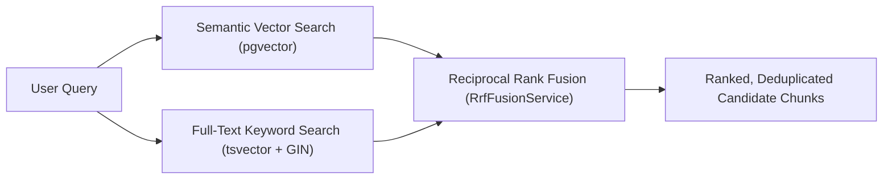

# OpsPilot AI – Hybrid Retrieval & PostgreSQL Full-Text Search

## 1. Overview of Hybrid Retrieval

Pure semantic vector search excels at conceptual similarity but can miss exact product codes, error codes, and technical jargon. Conversely, pure keyword search fails on synonyms and paraphrased questions.

OpsPilot AI implements **Hybrid Retrieval**, executing both strategies in parallel and fusing their ranked lists via **Reciprocal Rank Fusion (RRF)**.



## 2. PostgreSQL Full-Text Search Setup

Alembic migration `004_add_fts_to_document_chunks.py` adds a stored generated column and a GIN index on `ai.document_chunks`:

```sql
-- Generated tsvector column using language-neutral 'simple' dictionary
ALTER TABLE ai.document_chunks
ADD COLUMN search_vector tsvector
GENERATED ALWAYS AS (to_tsvector('simple', coalesce(content, ''))) STORED;

-- GIN Index for fast inverted index scans
CREATE INDEX idx_doc_chunks_search_vector ON ai.document_chunks USING gin(search_vector);
```

### Full-Text Search Query

```sql
SELECT
    c.id AS chunk_id,
    c.document_id,
    c.organization_id,
    c.processing_run_id,
    pr.processing_generation,
    c.chunk_index,
    c.content,
    c.char_start,
    c.char_end,
    c.page_start,
    c.page_end,
    c.section_title,
    c.metadata AS chunk_metadata,
    ts_rank_cd(c.search_vector, websearch_to_tsquery('simple', :query)) AS rank_score
FROM ai.document_chunks c
JOIN ai.document_processing_runs pr ON pr.id = c.processing_run_id
WHERE c.organization_id = :organization_id
  AND c.search_vector @@ websearch_to_tsquery('simple', :query)
ORDER BY rank_score DESC
LIMIT :candidate_limit;
```

`websearch_to_tsquery` supports natural phrases, double quotes (`"exact match"`), and `-negation` without requiring complex manual escaping.
