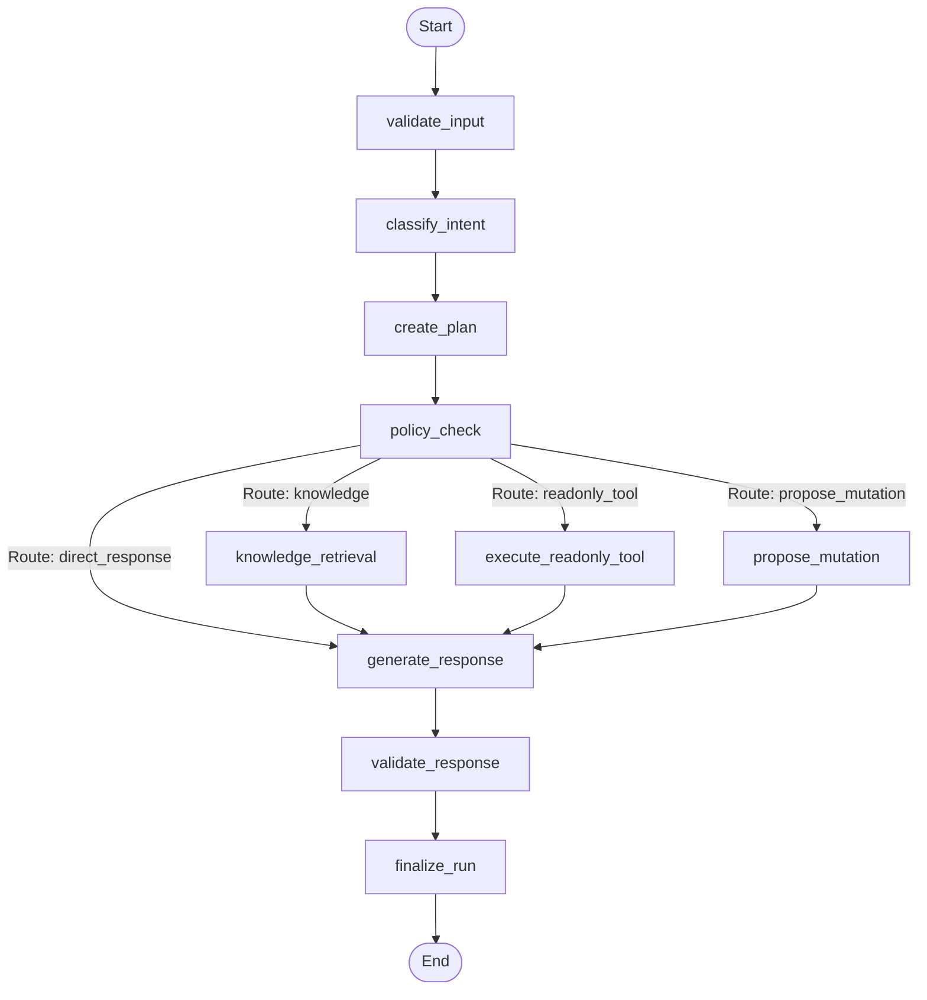

# LangGraph Workflow Architecture

## Overview

OpsPilot AI utilizes **LangGraph** (`langgraph>=1.2.19`) within the Python AI service (`apps/ai-service`) to construct deterministic, stateful, and observable operational workflows for enterprise AI agents.

While conventional AI agents rely on unconstrained tool execution loops that are prone to non-deterministic divergence and hallucinations, OpsPilot implements an explicit **Bounded Directed Acyclic Graph (DAG)** workflow pattern. Every workflow execution follows well-defined validation, classification, planning, policy checking, conditional execution, response generation, and post-generation verification phases.

---

## Architectural Principles

1. **Explicit Graph Topologies**:
   Workflows are defined as strongly-typed LangGraph `StateGraph` instances. Edges between nodes represent explicit deterministic state transitions or strictly bounded conditional routing.

2. **Decoupled Runtime Context & Graph State**:
   Mutable graph state (`OpsPilotWorkflowState`) contains exclusively operational fields (query, plan, intent, tool result, proposal, response, error). High-privilege tokens, API keys, and authorization credentials (`WorkflowContext`) are kept in runtime memory (`config["configurable"]["context"]`) and **never serialized into checkpointer stores**.

3. **Single Tool Invariant (Module 12)**:
   In Module 12, each workflow execution is bounded to a maximum of one primary operational action (either one read-only tool invocation or one mutation proposal). Unbounded looping is prevented by graph structure.

4. **Guaranteed Human-in-the-Loop Safeguards**:
   All state-changing operations (such as creating or updating support tickets) are routed through `propose_mutation`. The graph generates a cryptographically tracked action proposal and marks the run as `awaiting_approval`. No state mutation occurs without explicit operator review.

---

## Core Components

| Component             | File Path                                           | Description                                                                           |
| --------------------- | --------------------------------------------------- | ------------------------------------------------------------------------------------- |
| **Workflow State**    | `app/agents/state.py`                               | TypedDict defining all state attributes tracked across graph nodes                    |
| **Workflow Context**  | `app/agents/context.py`                             | Immutable context carrying tenant ID, user ID, role, and delegation assertion         |
| **Graph Builder**     | `app/agents/graphs/opspilot_graph.py`               | Constructs the compiled `StateGraph` with nodes, edges, and checkpointer              |
| **Workflow Router**   | `app/agents/routing/workflow_router.py`             | Evaluates policy decision and routes to knowledge, tool, proposal, or direct response |
| **Checkpointer**      | `app/agents/persistence/checkpointer.py`            | PostgreSQL state saver (`AsyncPostgresSaver`) for persistence and resumption          |
| **Execution Service** | `app/agents/services/workflow_execution_service.py` | Coordinates invocation, context binding, error normalization, and persistence         |
| **Status Service**    | `app/agents/services/workflow_status_service.py`    | Retrieves execution snapshots and history across checkpointer and database            |

---

## State Transitions & Node Execution Cycle

1. **`validate_input`**: Inspects user query length (1–5000 characters) and strips malicious control characters.
2. **`classify_intent`**: Utilizes structured LLM completion to categorize the user intent into one of 7 bounded categories (`knowledge_search`, `ticket_creation`, `ticket_update`, `ticket_lookup`, `user_lookup`, `support_history_query`, `general_question`, `unsupported_request`).
3. **`create_plan`**: Formulates a structured single-action execution plan, selecting the appropriate tool or retrieval space.
4. **`policy_check`**: Evaluates whether the authenticated user's organization role and delegation scopes authorize the planned action.
5. **Execution Nodes**:
   - `knowledge_retrieval`: Queries pgvector hybrid search via Module 09 RAG retrieval engine.
   - `execute_readonly_tool`: Invokes Module 11 tool registry for read-only tools (`get_ticket_details`, `search_user_information`, `summarize_support_history`).
   - `propose_mutation`: Invokes proposal-only tool endpoints (`create_support_ticket`, `update_support_ticket`) to generate an `awaiting_approval` action proposal.
6. **`generate_response`**: Synthesizes the final answer using retrieved evidence or tool outputs.
7. **`validate_response`**: Verifies evidence grounding and strips any citations not present in the retrieved context.
8. **`finalize_run`**: Computes total runtime duration and records run metrics.
