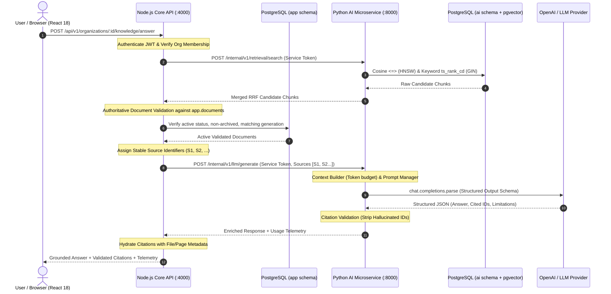

# LLM Integration & Intelligence Engine Architecture

## Overview

Module 10 establishes the **LLM Integration & Intelligence Engine** for OpsPilot AI. It bridges the authoritative Retrieval-Augmented Generation (RAG) retrieval engine (Module 09) with cognitive language models, synthesizing reliable, contextual, evidence-grounded answers based strictly on authorized corporate documents.

The architecture enforces a strict physical and logical boundary between high-throughput multi-tenant business operations (Node.js Express) and AI generation workflows (Python FastAPI).

---

## 1. System Topology & Request Flow

---

## 2. Architectural Boundaries & Division of Responsibility

| Capability                    | Node.js Express (`@opspilot/api`)                                       | Python Microservice (`ai-service`)                          |
| ----------------------------- | ----------------------------------------------------------------------- | ----------------------------------------------------------- |
| **Identity & Authentication** | JWT verification, active session checks, platform role checks           | Service-to-service internal bearer token verification       |
| **Multi-Tenancy**             | Route parameter matching, organization membership validation            | Strict query partitioning (`organization_id = :org_id`)     |
| **Authoritative State**       | Verifies `app.documents` status, `archived_at`, `processing_generation` | Read-only access to `ai.document_chunks` and embeddings     |
| **Source Attribution**        | Final authority mapping `S1..Sn` to document metadata and citations     | Passes stable source IDs and extracts cited IDs             |
| **Rate Limiting**             | Redis-backed distributed rate limiter per user/org                      | Bounded worker pools and timeouts                           |
| **LLM Lifecycle**             | Client invoking internal REST API                                       | Singleton `AsyncOpenAI` client connection management        |
| **Prompt Engineering**        | None (zero prompt leakage to Express)                                   | Centralized versioned prompt templates (`rag_assistant_v1`) |
| **Structured Output**         | TypeScript validation via Zod                                           | Pydantic v2 schema constraints with OpenAI parse API        |

---

## 3. Scope Boundaries & Anti-Patterns Avoided

- **No Agentic Tool Calling**: Module 10 does not implement autonomous tool execution, ticket updating, or API mutations. Agentic tools are deferred to Module 11+.
- **No Uncontrolled Hallucination**: An answer is generated only when supporting evidence is retrieved. If evidence is empty, the system terminates early (`insufficient_evidence: true`) without wasting LLM tokens.
- **No Client-Supplied Context**: The public endpoint accepts only queries and filters. Clients cannot inject arbitrary document text for the server to trust as citations.
- **No Secret Leakage**: The OpenAI API key resides solely within the Python AI microservice environment. It is never transmitted across network hops or logged.
