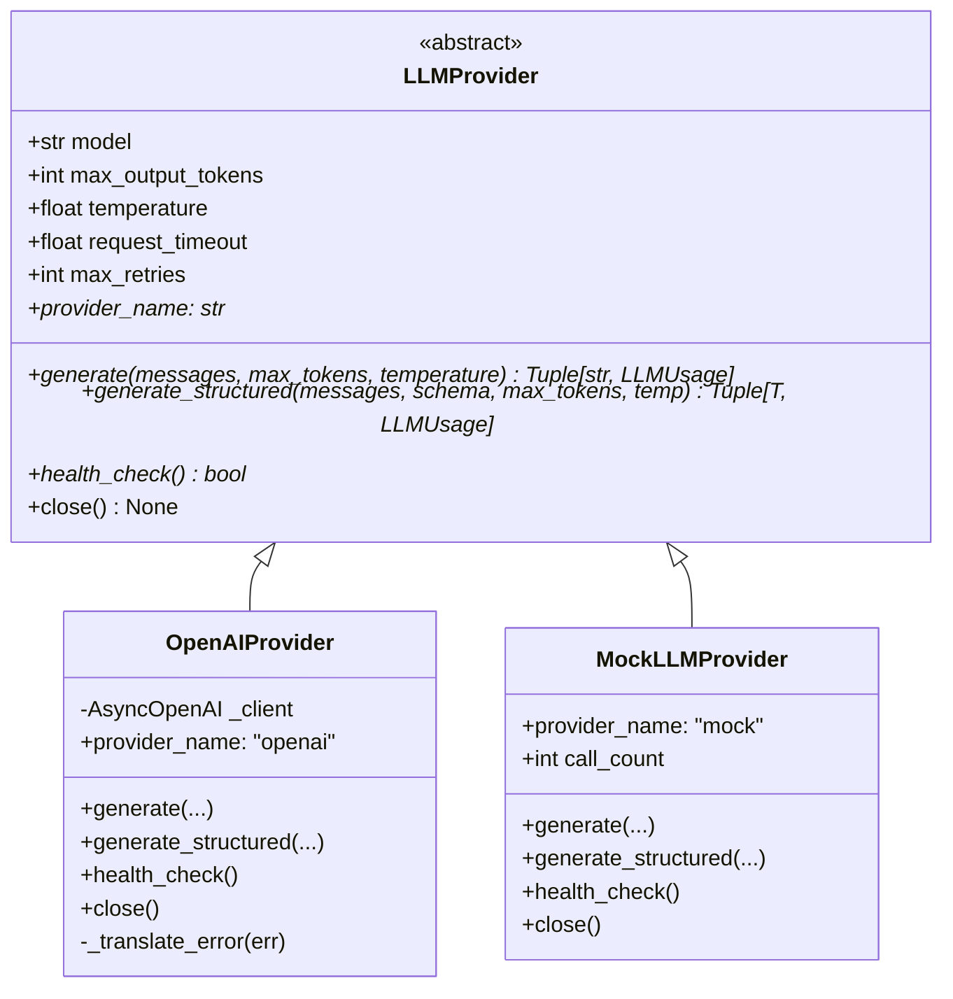

# LLM Provider Integration & Lifecycle

## Overview

OpsPilot AI decouples cognitive reasoning from specific cloud vendors through an extensible **LLM Provider Abstraction**. The system natively supports the official OpenAI Python SDK (`AsyncOpenAI`) while maintaining an offline, deterministic `MockLLMProvider` for isolated unit testing and CI pipelines.

---

## 1. Provider Abstraction Hierarchy



---

## 2. OpenAI Provider Implementation

The `OpenAIProvider` leverages the maintained `AsyncOpenAI` client:

```python
class OpenAIProvider(LLMProvider):
    def __init__(
        self,
        api_key: str,
        model: str = "gpt-4o-mini",
        max_output_tokens: int = 1500,
        temperature: float = 0.2,
        request_timeout: float = 60.0,
        max_retries: int = 3,
    ):
        super().__init__(model, max_output_tokens, temperature, request_timeout, max_retries)
        self._client = AsyncOpenAI(
            api_key=api_key,
            timeout=request_timeout,
            max_retries=max_retries,
        )
```

### Key Capabilities

1. **Structured Output Parse API**: Utilizes `client.beta.chat.completions.parse(..., response_format=response_schema)` for guaranteed JSON schema conformance.
2. **Graceful Fallbacks**: If `response.choices[0].message.parsed` is unavailable, performs secondary schema validation against `response_schema.model_validate_json(content)`.
3. **Finish Reason Auditing**: Detects `length` (raising `LLMOutputTruncatedError`) and `content_filter` (raising `LLMContentFilteredError`).
4. **Token Usage Extraction**: Accurately extracts `prompt_tokens`, `completion_tokens`, and `total_tokens` without synthetic approximation.

---

## 3. Centralized Client Lifecycle & Singleton Pattern

Creating new HTTP clients per request introduces TCP handshakes, memory leaks, and connection exhaustion under load. OpsPilot AI implements a thread-safe singleton lifecycle via `provider_factory.py`:

- **Startup**: `get_llm_provider()` initializes the shared provider upon first invocation.
- **Runtime**: Concurrent requests reuse the pooled connection pool.
- **Shutdown**: FastAPI `lifespan` triggers `await close_llm_provider()`, draining pending TCP sockets cleanly.

---

## 4. Standardized Error Translation

Vendor-specific exceptions from the OpenAI SDK are intercepted and normalized into OpsPilot's domain exception hierarchy:

| OpenAI Exception                    | OpsPilot Standardized Error | HTTP Status | Retryable |
| ----------------------------------- | --------------------------- | :---------: | :-------: |
| `AuthenticationError`               | `LLM_AUTHENTICATION_FAILED` |     401     |    No     |
| `RateLimitError` (RPM/TPM)          | `LLM_RATE_LIMITED`          |     429     |    Yes    |
| `RateLimitError` (Quota/Billing)    | `LLM_QUOTA_EXCEEDED`        |     429     |    No     |
| `APITimeoutError`                   | `LLM_TIMEOUT`               |     504     |    Yes    |
| `APIConnectionError`                | `LLM_PROVIDER_UNAVAILABLE`  |     503     |    Yes    |
| `InternalServerError`               | `LLM_PROVIDER_UNAVAILABLE`  |     503     |    Yes    |
| `BadRequestError` (Context Length)  | `LLM_CONTEXT_TOO_LARGE`     |     422     |    No     |
| `finish_reason == "content_filter"` | `LLM_CONTENT_FILTERED`      |     422     |    No     |
