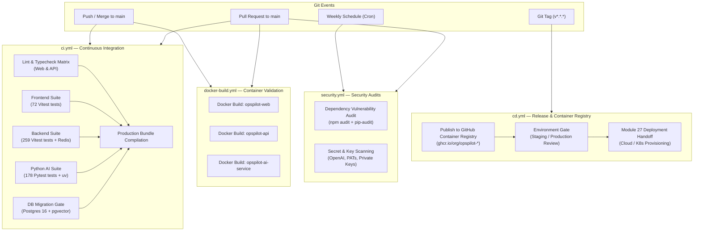

# Module 26: Continuous Integration & Continuous Delivery (CI/CD) Pipeline

## 1. Overview & Architectural Goals

Module 26 establishes enterprise-grade DevSecOps pipelines and containerization standards for the OpsPilot AI platform. As a polyglot monorepo comprising a React SPA (`apps/web`), an Express Node.js API (`apps/api`), and a Python FastAPI LangGraph microservice (`apps/ai-service`), the CI/CD pipeline enforces deterministic quality gates, automated security audits, bidirectional migration verification, and unprivileged container builds.

---

## 2. CI/CD Architecture & Pipeline Topography

---

## 3. Workflow Specifications

### 3.1 Monorepo CI Pipeline (`.github/workflows/ci.yml`)
- **Parallel Workspaces**: Evaluates `@opspilot/web`, `@opspilot/api`, and `apps/ai-service` in isolated runner containers.
- **Dependency Caching**: Utilizes native GitHub Actions caches for `npm` and `uv` packages to minimize pipeline execution times.
- **Service Containers**:
  - `redis:7-alpine`: Live Redis instance verifying queue interactions and cache managers.
  - `pgvector/pgvector:pg16`: Real PostgreSQL instance running schema creation and bidirectional migrations (`up` -> `down` -> `up`) for both `app` (Node-pg-migrate) and `ai` (Alembic) schemas.
- **Production Asset Compilation**: Confirms that Vite bundles and TypeScript declarations compile without bundle bloat or missing modules.

### 3.2 Security Scanning Pipeline (`.github/workflows/security.yml`)
- **Vulnerability Audit**: Automated checks against NPM and PyPI vulnerability advisories (`npm audit --audit-level=high` and `pip-audit`).
- **High-Entropy Secret Scanning**: Static pattern matching blocking unmasked API keys (`sk-*`), GitHub tokens (`ghp_*`), and RSA private keys before merge.

### 3.3 Container Build Validation (`.github/workflows/docker-build.yml`)
- Multi-architecture Docker Buildx execution validating that container recipes build cleanly on pull requests without publishing premature artifacts.

### 3.4 Continuous Delivery & Packaging (`.github/workflows/cd.yml`)
- Automatically publishes version-tagged container images to GitHub Container Registry (GHCR).
- Enforces semantic version tagging (`vX.Y.Z`) and Git commit SHA tagging for immutable rollbacks.
- **Boundary Demarcation**: Module 26 concludes with verified, scanned, and published container images in GHCR and environment promotion gates. Module 27 takes over live cloud provisioning (Terraform, Kubernetes, ECS, or cloud compute).

---

## 4. Container Optimization & Security Matrix

| Application | Base Image | Build Stage | Runtime Image | Non-Root User | Healthcheck Endpoint | Port |
| :--- | :--- | :--- | :--- | :---: | :--- | :---: |
| **Web SPA** | `node:22-alpine` | Vite + TypeScript | `nginx-unprivileged:alpine` | Yes (`nginx`) | `GET /healthz` | 8080 |
| **Node.js API** | `node:22-alpine` | `tsc` compile | `node:22-alpine` | Yes (`node:node`) | `GET /health/live` | 4000 |
| **Python AI Service** | `python:3.11-slim` | `uv` package sync | `python:3.11-slim` | Yes (`opspilot:10001`) | `GET /health/live` | 8000 |

### Key Container Hardening Safeguards:
1. **Unprivileged Execution**: No container runs as `root`. The web server utilizes Nginx unprivileged on port 8080; the API runs under user `node`; the AI service executes under dedicated system user `opspilot`.
2. **Minimal Attack Surface**: Build tools (`build-essential`, `typescript`, `ruff`) are isolated in build stages and omitted from runtime images.
3. **HTTP Healthchecks**: Built-in `HEALTHCHECK` directives guarantee Kubernetes and Docker orchestrators can automatically detect stalled or unresponsive services.
4. **Caching Headers**: Nginx server configuration caches immutable static assets (`/assets/`, max-age=31536000) while preventing stale index.html responses.
