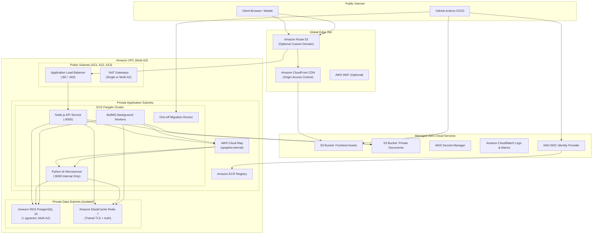

# Module 27: AWS Cloud Deployment Architecture & Infrastructure as Code

## 1. Overview & Architectural Goals

Module 27 establishes the complete AWS production infrastructure-as-code (IaC) and cloud architecture for the OpsPilot AI platform. The implementation provides a secure, multi-tier, highly available foundation for:
1. **React 18 SPA Frontend**: Hosted on Amazon S3 with global edge caching and DDoS protection via Amazon CloudFront using Origin Access Control (OAC).
2. **Node.js Express API**: Containerized on Amazon ECS with AWS Fargate behind a public Application Load Balancer (ALB).
3. **Python FastAPI LangGraph Microservice**: Containerized on Amazon ECS with AWS Fargate, isolated in private subnets with internal service discovery via AWS Cloud Map (`ai-service.opspilot.internal:8000`).
4. **BullMQ Background Workers**: Ephemeral, autoscaling ECS Fargate worker tasks processing document ingestion, embedding generation, and outbox approvals.
5. **PostgreSQL 16 with pgvector**: Managed database on Amazon RDS with custom parameter groups enabling vector search, automated backups, and encryption at rest.
6. **Redis 7 In-Memory Cache & Queues**: Managed cluster on Amazon ElastiCache for Redis with in-transit TLS and at-rest encryption.
7. **Private Organizational Document Storage**: Dedicated Amazon S3 bucket with server-side encryption, versioning, and strict IAM access boundaries.
8. **Secrets & Identity**: Centralized encryption in AWS Secrets Manager and keyless CI/CD deployments via GitHub Actions OpenID Connect (OIDC) federation.

---

## 2. Target AWS Cloud Topology



---

## 3. Service Mapping & Architectural Responsibilities

| Application Service | AWS Target Resource | Subnet Tier | Ingress Exposure | Healthcheck Endpoint |
| :--- | :--- | :--- | :--- | :--- |
| **Frontend SPA** | S3 + CloudFront (OAC) | Global Edge | Public HTTPS (:443) | `GET /index.html` |
| **Node.js Core API** | ECS Fargate (`api`) | Private Application | Ingress from ALB (:4000) | `GET /health/live` |
| **Python AI Service** | ECS Fargate (`ai-service`) | Private Application | Internal Cloud Map (:8000) | `GET /health/live` |
| **Background Workers** | ECS Fargate (`workers`) | Private Application | None (Pull model from Redis) | Process exit / heartbeat |
| **Migration Runner** | ECS One-off Task | Private Application | None (Ephemeral batch task) | Container exit code 0 |
| **PostgreSQL 16** | Amazon RDS PostgreSQL | Private Data | Port 5432 from App/Worker SGs | `pg_isready` |
| **Redis 7** | Amazon ElastiCache | Private Data | Port 6379 from App/Worker SGs | Redis `PING` |
| **Document Storage** | Amazon S3 (Private) | AWS Cloud | IAM Authenticated API/Worker | TLS SigV4 REST API |

---

## 4. Multi-Tenant Database & Schema Separation

The AWS RDS PostgreSQL instance preserves the strict schema ownership boundaries established across Modules 02–26:
- **`app` Schema**: Owned exclusively by database user `opspilot_api`. Houses user accounts, organizations, memberships, permissions, tickets, action proposals, approvals, and outbox tables. Migrated via `node-pg-migrate`.
- **`ai` Schema**: Owned exclusively by database user `opspilot_ai`. Houses document processing records, chunks, vector embeddings (`vector(1536)`), LangGraph thread checkpoints, user memories, and evaluation datasets. Migrated via `alembic`.
- **pgvector Compatibility**: Enabled in RDS PostgreSQL 16 using a custom DB parameter group setting:
  ```hcl
  parameter {
    name  = "shared_preload_libraries"
    value = "vector"
  }
  ```

---

## 5. Storage & S3 Document Adapter

The application features a production S3 adapter (`apps/api/src/modules/documents/storage/s3-storage.provider.ts`) implementing `IStorageProvider`:
- Activated when `DOCUMENT_STORAGE_PROVIDER='s3'`.
- All object keys are prefixed by organization ID: `${organizationId}/${storageKey}`.
- Path traversal sequences (`..`) are strictly rejected before dispatching requests to AWS.
- All uploads enforce server-side AES-256 encryption.
- Direct public URLs are never generated; authenticated client downloads stream through Node.js API authorization pipelines.

---

## 6. Infrastructure-as-Code Structure

The Terraform codebase is structured cleanly in `infrastructure/terraform/`:
- **`bootstrap/`**: Provisions the remote state S3 bucket (`opspilot-terraform-state-<account-id>`) with versioning, encryption, and DynamoDB state locking table (`opspilot-terraform-locks`).
- **`modules/`**:
  - `vpc`: Multi-AZ subnets, configurable NAT gateway topology, S3 VPC endpoint.
  - `security_groups`: Fine-grained network access controls between tiers.
  - `s3_frontend`: Private S3 bucket, CloudFront OAC, SPA 403/404 routing.
  - `s3_documents`: Versioned, encrypted, TLS-only organizational document bucket.
  - `rds_postgres`: PostgreSQL 16 RDS instance with pgvector parameter group.
  - `elasticache_redis`: Redis 7 replication group with in-transit TLS.
  - `iam`: ECS execution roles, least-privilege task roles, GitHub Actions OIDC federation.
  - `secrets`: AWS Secrets Manager definitions with auto-generated passwords.
  - `alb`: Application Load Balancer with health checks and API path routing.
  - `ecs`: ECS cluster, Fargate task definitions, services, and target-tracking autoscaling.
  - `cloudwatch`: Log groups, metric alarms (CPU, memory, 5xx, storage), and SNS alert topic.
- **`environments/`**:
  - `dev/`: Cost-optimized development environment (single NAT, `t4g.micro`, 7-day logs).
  - `staging/`: Pre-production environment (single NAT, `t4g.small`, 14-day logs).
  - `production/`: High-availability enterprise environment (multi-AZ NAT, `m6g.large`, multi-AZ RDS, 90-day logs, deletion protection).

---

## 7. Cost Drivers & Operational Estimates

| Component | Dev / Staging (Monthly Est.) | Production (Monthly Est.) | Cost Driver & Optimization Strategy |
| :--- | :---: | :---: | :--- |
| **NAT Gateways** | ~$32 (1 Single NAT) | ~$96 (3 Multi-AZ NATs) | Single NAT in non-prod saves ~$64/month. Gateway endpoint for S3 eliminates S3 data transfer NAT fees. |
| **ECS Fargate** | ~$25 (0.5 vCPU, 1 GB) | ~$140 (Autoscaling 2–10 tasks) | Tasks in private subnets scale dynamically based on CPU/memory load. |
| **RDS PostgreSQL** | ~$20 (`db.t4g.small`, Single-AZ) | ~$175 (`db.m6g.large`, Multi-AZ) | Multi-AZ with automated failover only enabled in production. |
| **ElastiCache Redis** | ~$15 (`cache.t4g.micro`, 1 node) | ~$110 (`cache.m6g.large`, 2 nodes) | Multi-cluster replication with automatic failover enabled in production. |
| **Application Load Balancer** | ~$22 (1 ALB) | ~$28 (ALB with higher LCU load) | Standard hourly charge + LCU usage. |
| **S3 & CloudFront** | ~$5 | ~$25 (Scale with traffic & docs) | CloudFront edge caching offloads 90%+ of frontend requests from S3. |
| **CloudWatch & Secrets** | ~$5 | ~$15 | Log retention capped at 14 days (staging) vs. 90 days (production). |
| **Estimated Monthly Total** | **~$124 / month** | **~$589 / month** | *Estimates based on US East (N. Virginia) pricing.* |

---

## 8. Rollback & Disaster Recovery Procedures

1. **ECS Application Rollback**:
   - Deployment circuit breakers are enabled (`rollback = true`).
   - If an updated task fails health checks (`/health/live`) within 3 attempts or during 15–20s start periods, ECS automatically aborts rollout and rolls back to the previous stable task definition revision without operator intervention.
2. **Database Point-in-Time Recovery (PITR)**:
   - RDS automated daily snapshots and transaction logs allow rolling back the database to any second within the retention window (7 days staging, 30 days prod).
3. **Frontend Static Rollback**:
   - Previous S3 build versions are preserved; CloudFront invalidations (`/*`) complete within 60–120 seconds.
4. **Disaster Recovery Targets (SLA Targets)**:
   - **RPO (Recovery Point Objective)**: < 5 minutes (via RDS continuous automated WAL archiving).
   - **RTO (Recovery Time Objective)**: < 30 minutes (automated ECS container recreation and RDS point-in-time restore).

---

## 9. Deployment Authorization & Mandatory Safety Gate

In strict accordance with enterprise safety guidelines:
- **No billable AWS resources have been automatically provisioned.**
- All infrastructure exists as verified, strongly typed, modular Terraform definitions and GitHub Actions workflows.
- Execution of `terraform apply` requires explicit approval and credential configuration by the account owner.
