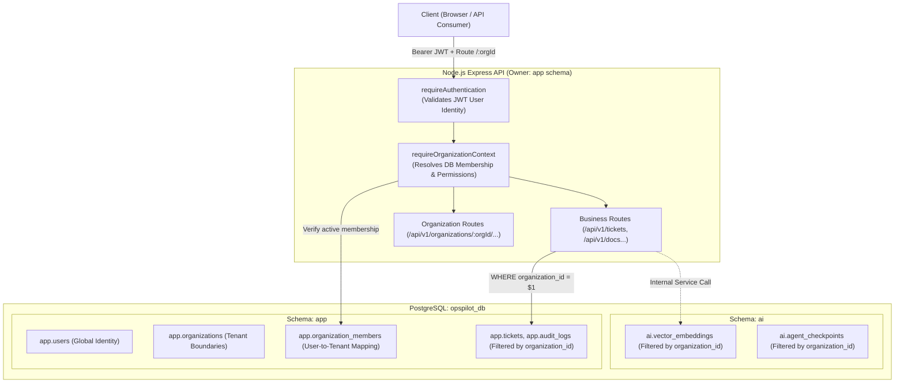

# OpsPilot AI – Multi-Tenancy Architecture

This document specifies the multi-tenant isolation model, tenant context resolution mechanisms, database schemas, and architectural boundaries for **OpsPilot AI**.

---

## 1. Multi-Tenancy Strategy

OpsPilot AI implements a **Logical Shared-Database, Row-Level Isolation** architecture. All tenants reside within a shared PostgreSQL database (`opspilot_db`), but tenant data is partitioned logically by `organization_id`.



---

## 2. Decoupling Global Identity from Tenant Membership

### 2.1 Why Access Tokens Do Not Encode Organization Claims

Many systems naively embed organization IDs or tenant roles inside the user's JWT access token. OpsPilot AI strictly avoids this practice for three critical reasons:

1. **Stale Permissions & Revocation Delay**: If a user is removed from an organization or their role is changed from `admin` to `member`, a stateless JWT containing the old role would permit unauthorized actions until the token expires.
2. **Multi-Organization Scale**: An enterprise user may belong to dozens or hundreds of workspaces. Storing tenant memberships in the JWT causes HTTP header overflow and token bloat.
3. **Race-Free Authorization**: Membership and role lookup is performed against authoritative database state within the request lifecycle, ensuring instantaneous enforcement of removals or demotions.

### 2.2 Platform Roles vs Organization Roles

Platform roles are completely decoupled from organization roles:

```
+-----------------------------------------------------------+
|                      Platform Roles                       |
|           app.users.platform_role: user | platform_admin   |
+-----------------------------------------------------------+
                             |
                             |  Has no automatic access to
                             v
+-----------------------------------------------------------+
|                   Organization Memberships                |
|       app.organization_members.role: owner | admin | member|
+-----------------------------------------------------------+
```

- **`platform_admin`**: Manages global server health, system configurations, and platform maintenance. A `platform_admin` **does not** automatically receive membership, visibility, or access to private organization workspaces.
- To access organization data, any user (including platform admins) must hold an active entry in `app.organization_members`.

---

## 3. Request Lifecycle & Context Middleware

All tenant-scoped API requests are passed through `requireOrganizationContext`:

```ts
export const requireOrganizationContext = async (
  req: Request,
  res: Response,
  next: NextFunction
): Promise<void> => {
  // 1. Authenticate user identity
  if (!req.user) return res.status(401).json({ code: 'UNAUTHORIZED' });

  // 2. Extract and validate organization UUID
  const organizationId = req.params.organizationId;
  if (!isValidUUID(organizationId))
    return res.status(400).json({ code: 'INVALID_ORGANIZATION_ID' });

  // 3. Verify organization exists and is active
  const org = await organizationRepository.findById(organizationId);
  if (!org) return res.status(404).json({ code: 'ORGANIZATION_NOT_FOUND' });
  if (org.status === 'archived') return res.status(403).json({ code: 'ORGANIZATION_ARCHIVED' });
  if (org.status === 'suspended') return res.status(403).json({ code: 'ORGANIZATION_SUSPENDED' });

  // 4. Resolve active membership directly from DB
  const membership = await memberRepository.findByOrgAndUser(organizationId, req.user.id);
  if (!membership || membership.status !== 'active') {
    return res.status(403).json({ code: 'FORBIDDEN_NOT_ORGANIZATION_MEMBER' });
  }

  // 5. Attach OrganizationContext to Request object
  req.organization = {
    id: org.id,
    name: org.name,
    slug: org.slug,
    role: membership.role,
    membershipId: membership.id,
    permissions: ROLE_PERMISSIONS[membership.role],
  };

  next();
};
```

---

## 4. Database Isolation Principles

### 4.1 Strict Schema Constraints

1. **Foreign Key Integrity**: Every tenant-owned table MUST declare a foreign key constraint referencing `app.organizations(id)`:
   ```sql
   organization_id UUID NOT NULL REFERENCES app.organizations(id) ON DELETE CASCADE
   ```
2. **Explicit Query Scoping**: Repositories MUST explicitly parameterize `WHERE organization_id = $1` on all select, update, and delete statements. Code reviews reject queries that rely solely on row IDs without tenant scoping.
3. **Compound Indexes**: Queries filtering by tenant and secondary criteria must be supported by compound indexes:
   ```sql
   CREATE INDEX idx_tickets_org_status ON app.tickets (organization_id, status);
   ```

### 4.2 Cross-Tenant Contamination Defense (Anti-IDOR)

Insecure Direct Object Reference (IDOR) attacks are eliminated by requiring both `organizationId` from context and target entity ID in database queries:

```sql
-- Safe: Guarantees resource belongs to the caller's active organization context
SELECT * FROM app.support_tickets
WHERE id = $1 AND organization_id = $2;
```

---

## 5. Cross-Service Boundaries: Node.js API & Python AI Microservice

The separation of responsibilities between Node.js and Python FastAPI is strictly preserved:

1. **Ownership of Organization Data**:
   - Node.js Express owns `app.organizations`, `app.organization_members`, and tenant authorization.
   - The Python AI microservice **never** queries or modifies organization memberships directly.
2. **AI Microservice Invocations**:
   - When Node.js dispatches RAG indexing or LangGraph execution to Python AI service, it passes verified `organization_id` in the internal payload or mTLS/token-authenticated service headers.
   - In the `ai` database schema, all vector embeddings (`ai.document_embeddings`) and agent checkpoints (`ai.agent_memories`) store `organization_id UUID NOT NULL`.
   - Python vector queries explicitly constrain cosine similarity searches:
     ```sql
     SELECT id, content, 1 - (embedding <=> $1) AS similarity
     FROM ai.document_embeddings
     WHERE organization_id = $2
     ORDER BY similarity DESC LIMIT 5;
     ```

This guarantees that semantic searches or LLM agent memory lookups never retrieve documents or context from other organizations.
