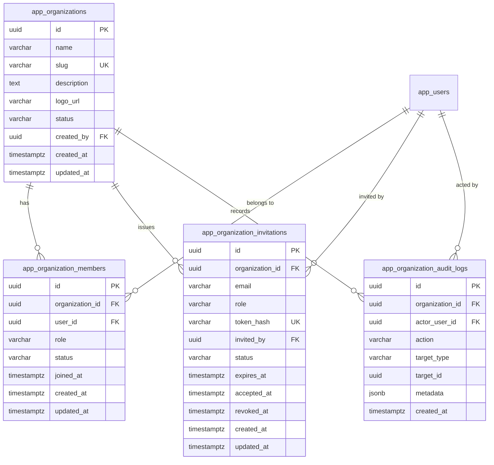
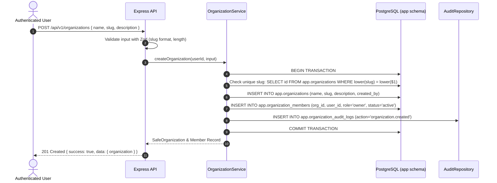
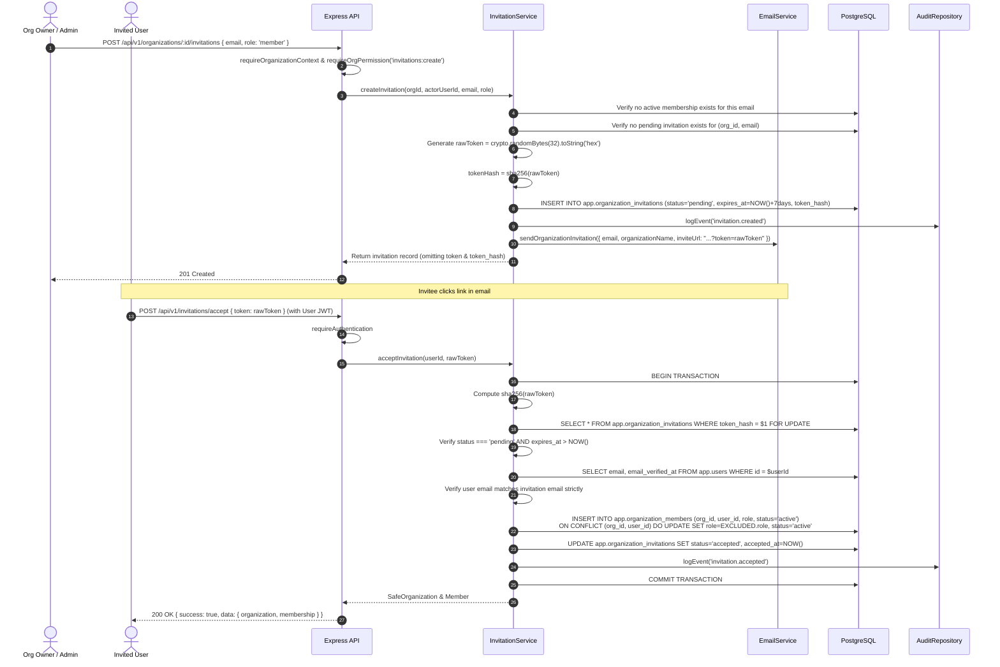
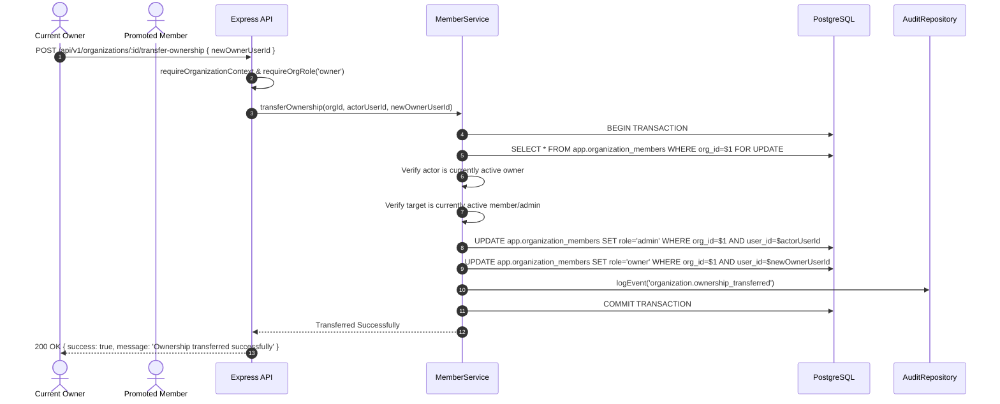

# OpsPilot AI – Organization Architecture

This document describes the architectural design, lifecycle, data models, state machines, and workflows of the Organization Management system implemented in Module 04 for **OpsPilot AI**.

---

## 1. Architectural Overview

OpsPilot AI is built as a multi-tenant enterprise platform. The Organization system serves as the foundational multi-tenant boundary for teams, workspaces, support tickets, knowledge bases, and AI agent workloads.



---

## 2. Core Entities & Lifecycle

### 2.1 Organizations (`app.organizations`)

Organizations represent the top-level tenant workspace.

| Field                       | Type           | Description                                              |
| --------------------------- | -------------- | -------------------------------------------------------- |
| `id`                        | `UUID`         | Primary key (`gen_random_uuid()`)                        |
| `name`                      | `VARCHAR(100)` | Human-readable organization name (e.g., "Acme Corp")     |
| `slug`                      | `VARCHAR(100)` | URL-safe slug, unique case-insensitive via `lower(slug)` |
| `description`               | `TEXT`         | Optional workspace description                           |
| `logo_url`                  | `VARCHAR(500)` | Optional URL for the organization avatar                 |
| `status`                    | `VARCHAR(20)`  | `active`, `suspended`, or `archived`                     |
| `created_by`                | `UUID`         | Foreign key to `app.users(id)`                           |
| `created_at` / `updated_at` | `TIMESTAMPTZ`  | Temporal tracking                                        |

#### Organization Status States

- **`active`**: Normal operational state. Members can access all organization resources according to their roles.
- **`suspended`**: Administratively locked (e.g. for policy violations). All access returns `403 FORBIDDEN` with code `ORGANIZATION_SUSPENDED`.
- **`archived`**: Soft-deleted by the primary owner. Organization is read-protected and returns `403 FORBIDDEN` with code `ORGANIZATION_ARCHIVED`.

---

### 2.2 Memberships (`app.organization_members`)

A user's relationship with an organization is defined by explicit membership rows.

| Role     | Description                                                                                                                             |
| -------- | --------------------------------------------------------------------------------------------------------------------------------------- |
| `owner`  | Supreme administrator. Has complete control including archiving and ownership transfer. Exactly **one** active owner per organization.  |
| `admin`  | Organization administrator. Can invite standard members, manage settings, and view audit logs. Cannot manage other admins or the owner. |
| `member` | Standard workspace member. Can view organization details and fellow members. Cannot invite or mutate settings.                          |

#### Database-Enforced Single Owner Invariant

To prevent split-brain leadership or unowned organizations, the database enforces exactly one active owner per organization using a PostgreSQL partial unique index:

```sql
CREATE UNIQUE INDEX idx_org_members_one_active_owner
ON app.organization_members (organization_id)
WHERE (role = 'owner' AND status = 'active');
```

---

## 3. Workflows & Sequences

### 3.1 Organization Creation Workflow

When a user creates an organization, the creation and initial owner assignment execute inside a single atomic database transaction.



---

### 3.2 Member Invitation & Acceptance Flow

Invitations use cryptographic single-use tokens hashed with SHA-256 before database persistence. Raw tokens are sent exclusively via email and are never stored in the database or returned in API responses.



---

### 3.3 Atomic Ownership Transfer Flow

Ownership transfer reassigns the `owner` role from the current owner to an existing active member while simultaneously demoting the previous owner to `admin`. This operation is strictly protected by row-level locks and transaction boundaries.



---

## 4. Audit Logging Architecture

Every security-sensitive event emits an immutable audit entry into `app.organization_audit_logs`.

### Captured Actions

- `organization.created`
- `organization.updated`
- `organization.archived`
- `organization.ownership_transferred`
- `member.role_updated`
- `member.removed`
- `member.left`
- `invitation.created`
- `invitation.accepted`
- `invitation.revoked`
- `invitation.resent`

Audit logs cannot be updated or deleted through the API.
