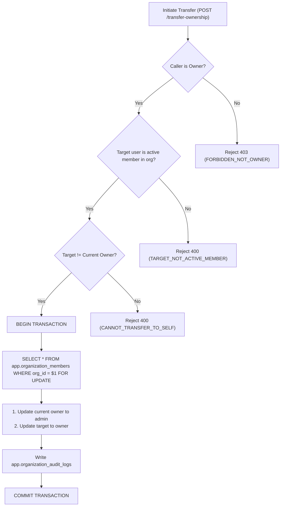

# OpsPilot AI – Organization Security & Tenant Isolation

This document outlines the security architecture, threat model, defenses against tenant cross-contamination, cryptographic token handling, and audit trails implemented in Module 04 for **OpsPilot AI**.

---

## 1. Threat Model & Mitigation Matrix

| Threat                                      | Attack Vector                                                                               | OpsPilot AI Defense                                                                                                                                                     |
| ------------------------------------------- | ------------------------------------------------------------------------------------------- | ----------------------------------------------------------------------------------------------------------------------------------------------------------------------- |
| **Insecure Direct Object Reference (IDOR)** | User passes arbitrary `organizationId` or resource UUID belonging to another tenant in URL. | `requireOrganizationContext` queries `app.organization_members` for `(organization_id, user_id)` and status = `'active'`. Rejects with `403 FORBIDDEN` if not a member. |
| **Organization Enumeration**                | Attacker probes random UUIDs to discover valid workspace IDs.                               | Non-existent organizations or unauthorized IDs return `404` or `403` uniformly without leaking metadata or tenant names.                                                |
| **Stale JWT Authorization**                 | Removed member retains valid JWT access token and continues making API calls.               | Authorization is NOT derived from stateless JWT claims. Database membership is verified dynamically on every request.                                                   |
| **Split-Brain Ownership**                   | Race condition concurrent requests attempt to create multiple owners.                       | PostgreSQL partial unique index `idx_org_members_one_active_owner` rejects duplicate active owners at the database level.                                               |
| **Account Takeover via Invite Link**        | Attacker intercepts invitation link sent to a victim's email.                               | Accepting an invitation requires authentication AND strict equality check: the accepting user's verified email must match the invitation recipient email.               |
| **Token Theft from Database**               | Compromise of database reveals raw invitation tokens.                                       | Raw tokens are NEVER persisted. Only cryptographically secure SHA-256 hashes (`token_hash`) are stored.                                                                 |
| **Timing Attacks on Token Verification**    | Side-channel timing comparison of token hashes.                                             | SHA-256 digest comparison executed with fixed length hex strings and constant-time database indexing.                                                                   |
| **Admin Privilege Escalation**              | Admin attempts to elevate privileges to owner or remove owner.                              | Role hierarchy strictly forbids admins from modifying admins or owners, and forbids promoting to owner without ownership transfer.                                      |

---

## 2. Cryptographic Invitation Lifecycle

```
[Raw Token Generation]
crypto.randomBytes(32).toString('hex')  --> 64-character high-entropy hex string
                 |
                 +-----> Sent via email link: ?token=<rawToken>
                 |
[Hashing Layer]
crypto.createHash('sha256').update(rawToken).digest('hex')
                 |
                 +-----> Stored in app.organization_invitations.token_hash
```

### Security Rules

1. **No Raw Token Persistence**: The raw token is generated in memory, dispatched via email, and immediately discarded from RAM. It is never written to disk, database, or logging subsystems.
2. **Deterministic Hash Lookup**: When a user submits a token to `/api/v1/invitations/accept`, the backend hashes the incoming string and queries `WHERE token_hash = $1`.
3. **Single-Use Enforcement**: Inside a transactional row lock (`SELECT ... FOR UPDATE`), the status transitions atomically from `pending` to `accepted`. Any subsequent attempt fails with `INVITATION_NOT_PENDING`.
4. **Time-Bound Validity**: Every invitation expires automatically 7 days after dispatch (`expires_at = NOW() + INTERVAL '7 days'`).

---

## 3. Atomic Ownership Transfer Security

Ownership transfer is a high-risk operation. It is protected by multiple defensive layers:



- **Row Locks (`FOR UPDATE`)**: Prevents race conditions if two transfer requests or simultaneous role updates occur concurrently.
- **Frontend Confirmation Dialog**: Requires the user to type `"TRANSFER"` in all capital letters before unlocking the submission button to prevent accidental clicks.

---

## 4. Multi-Tenant Cross-Contamination Defense in Future AI Modules

When implementing Module 05+ (Support Tickets, RAG, LangGraph AI Agents):

1. **Schema Partitioning**:
   - `app` schema: Express owns business logic and tenant mappings.
   - `ai` schema: Python FastAPI owns vectors and agent state.
2. **Tenant Parameterization**:
   - Every table in both `app` and `ai` schemas that holds tenant-specific data must include:
     ```sql
     organization_id UUID NOT NULL REFERENCES app.organizations(id) ON DELETE CASCADE
     ```
3. **AI Microservice Isolation**:
   - Python FastAPI never performs unbounded vector searches.
   - All similarity search queries filter strictly by `WHERE organization_id = :org_id`.
   - Redis caching for AI conversations must namespace keys by tenant:
     `rag:org:<organization_id>:doc:<doc_id>`
     `agent:org:<organization_id>:session:<session_id>`
