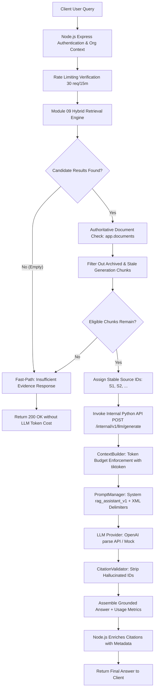

# RAG Grounded Answer Generation

## Overview

The answer generation pipeline in OpsPilot AI combines authoritative database verification, token-bounded context construction, and schema-constrained LLM generation into an end-to-end trustworthy workflow.

---

## 1. End-to-End Workflow Diagram

---

## 2. Fast-Path Optimization

A common deficiency in naive RAG systems is invoking costly LLM models even when search returns zero relevant chunks. OpsPilot AI implements a **Fast-Path Short-Circuit**:

1. If the retrieval engine returns 0 candidate chunks, the `KnowledgeAnswerService` terminates the request immediately.
2. It returns a standardized response (`insufficientEvidence: true`, `citations: []`, latency $\le 5\text{ms}$).
3. This eliminates unneeded API latency, conserves LLM token quotas, and guarantees zero hallucination on unknown topics.

---

## 3. Token & Context Budget Management

The `ContextBuilder` (`app/llm/services/context_builder.py`) ensures that input context does not overwhelm model token limits:

- **Accurate Tokenization**: Uses `tiktoken.encoding_for_model(model)` (e.g. `o200k_base` for `gpt-4o-mini`, `cl100k_base` fallback) rather than imprecise character-to-token heuristics.
- **Top-Ranked Preservation**: Sorts chunks by retrieval relevance score (RRF rank). Chunks are appended sequentially until the cumulative budget (`LLM_MAX_CONTEXT_TOKENS`, default 8,000) is reached.
- **Controlled Truncation**: When the budget is reached, lower-ranked chunks are omitted, logging a structured telemetry warning. High-ranked evidence is never truncated midway through a passage.

---

## 4. Authoritative Verification

The Node.js Express tier retains final authority over document eligibility:

- Candidates returned by the Python AI service must exist in `app.documents`.
- `status` must equal `'active'`.
- `archived_at` must be `NULL`.
- `processing_generation` must match the candidate's indexing generation.
  Chunks from deleted, superseded, or archived documents are stripped before reaching the prompt context.
