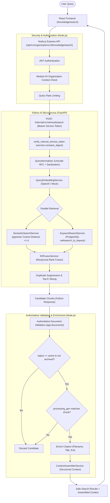

# OpsPilot AI – RAG Retrieval Architecture

## 1. Architectural Overview

Module 09 implements the tenant-isolated Retrieval-Augmented Generation (RAG) retrieval engine for OpsPilot AI. The engine accepts user queries, produces query vector embeddings in the exact model space, executes parallel semantic vector search (via PostgreSQL `pgvector`) and keyword full-text search (via PostgreSQL `tsvector` + GIN indexing), combines candidate results using Reciprocal Rank Fusion (RRF), enforces authoritative document-level eligibility validation in Node.js, enriches citations, and packages a structured context payload for downstream LLM generation in Module 10.

## 2. Core Service Boundaries

1. **Node.js Express Backend**:
   - Owns identity, tenant context verification (`requireOrganizationContext`), input validation (Zod), rate limiting, and authoritative document verification against `app.documents`.
   - Discards stale generation candidates and archived document passages before any content is surfaced.
2. **Python FastAPI AI Microservice**:
   - Owns query embedding, pgvector semantic search (`ai.document_chunk_embeddings`), full-text search (`ai.document_chunks`), Reciprocal Rank Fusion, and candidate chunk assembly.
   - Operates in the `ai` database schema and communicates exclusively over authenticated internal service-to-service channels.
3. **PostgreSQL Database**:
   - `ai.document_chunk_embeddings`: Persistent 1536-dim vector storage with HNSW index (`vector_cosine_ops`, `m = 16`, `ef_construction = 64`).
   - `ai.document_chunks`: Extracted text chunks with stored `search_vector tsvector` and GIN index.
   - `app.documents`: Authoritative document lifecycle, archive timestamps, and processing generations.
