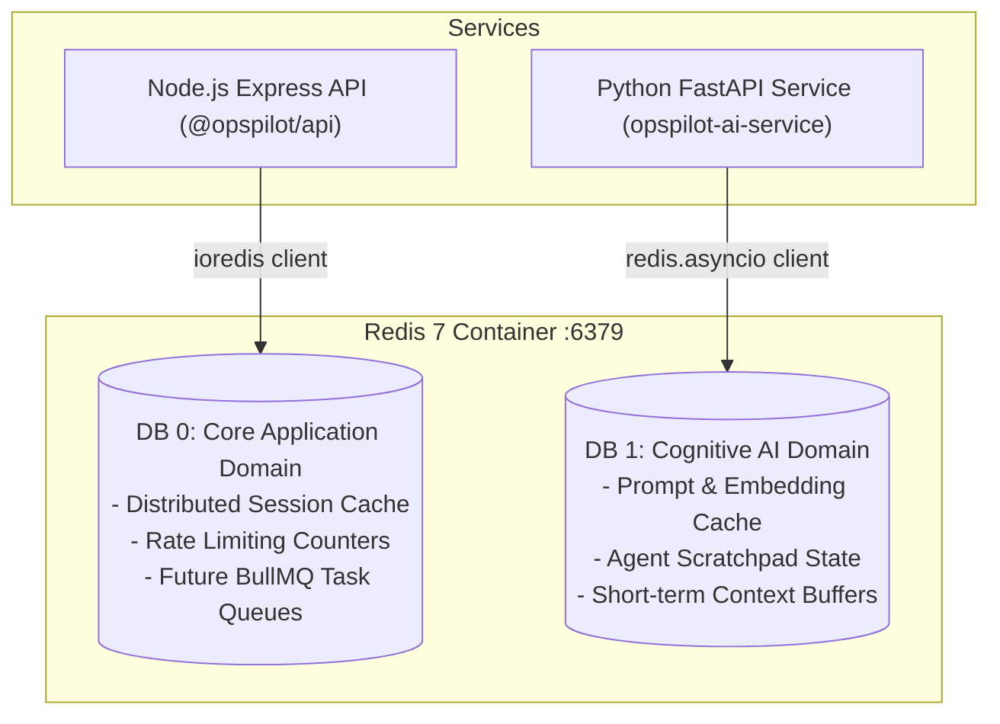

# OpsPilot AI — Redis Architecture & Caching Strategy

This document details the configuration, logical database allocation, client design, and durability guarantees of the Redis infrastructure.

---

## 1. Engine & Durability Configuration

- **Engine**: Redis 7 Alpine
- **Persistence Mode**: Append-Only File (`appendonly yes`) enabled. Every write operation is logged to disk in the `opspilot_redis_data` volume, ensuring high durability across restarts.
- **Access Control**: Password-protected via `--requirepass` directive matching `REDIS_PASSWORD`.
- **Port**: Bound strictly to `127.0.0.1:6379`.

---

## 2. Logical Database Allocation

Redis partitions data into logical numerical databases (0 to 15):

---

## 3. Client Implementation

### Node.js Backend (`ioredis`)

- **Compatibility**: Pre-configured for seamless integration with **BullMQ** in future modules (`maxRetriesPerRequest: null`).
- **Connection Strategy**: Lazy connection with exponential backoff retry jitter.
- **Graceful Shutdown**: Intercepts `SIGTERM` / `SIGINT` to issue `redis.quit()` before process termination.

### Python Microservice (`redis.asyncio`)

- **Asynchronous Execution**: Fully non-blocking event-loop integration.
- **Lifecycle Integration**: Managed through FastAPI lifespan context manager (`app/main.py`), ensuring connection pools are cleanly closed on application shutdown.
- **Health Verification**: Exposes `check_redis_health()` executing `await redis.ping()` with latency measurements.
