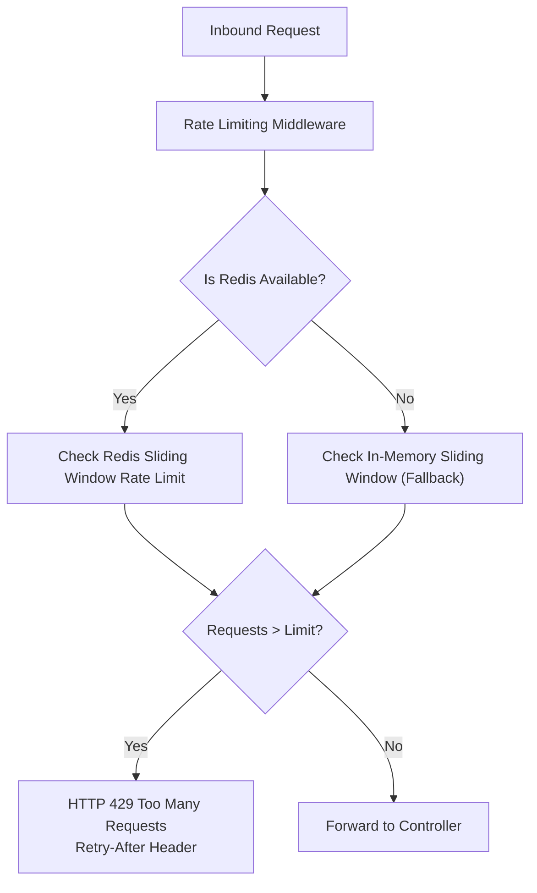

# OpsPilot AI — Security Architecture & Threat Defense

## 1. Executive Summary

The OpsPilot AI security architecture is engineered to provide military-grade confidentiality, integrity, and availability for mission-critical enterprise environments.

Every architectural boundary, authentication handshake, and database interaction follows the Principle of Least Privilege (PoLP) and defense-in-depth principles.

---

## 2. OWASP Top 10 (2021) Compliance Matrix

| Vulnerability Category                  | Risk Description                                                         | OpsPilot AI Architectural Defense & Evidence                                                                                                                                                                                                                                                                               |
| :-------------------------------------- | :----------------------------------------------------------------------- | :------------------------------------------------------------------------------------------------------------------------------------------------------------------------------------------------------------------------------------------------------------------------------------------------------------------------- |
| **A01: Broken Access Control**          | Unauthorized privilege escalation or cross-tenant data access.           | - Rigid separation between `app` (Node) and `ai` (Python) database schemas with cross-schema revokes.<br/>- `requireAuthentication` verifies cryptographically signed JWTs.<br/>- `requirePlatformRole` blocks unauthorized users at route boundaries.<br/>- Public registration strictly enforces `'user'` platform role. |
| **A02: Cryptographic Failures**         | Compromised credentials, weak hashing, or token leakage.                 | - **Argon2id** password hashing with memory and time hardness.<br/>- SHA-256 one-way hashing for all persistent refresh and reset tokens.<br/>- 256-bit entropy random tokens via `crypto.randomBytes`.<br/>- Strict TLS / HTTPS enforcement in production with HSTS (`helmet`).                                           |
| **A03: Injection**                      | SQL injection, NoSQL injection, or command execution.                    | - 100% parameterized queries via PostgreSQL driver (`pg`). No raw string concatenation in SQL queries.<br/>- Zod schema validation on every inbound request payload before controllers receive data.                                                                                                                       |
| **A04: Insecure Design**                | Architectural flaws, missing rate limits, or unmitigated replay attacks. | - Token Family tracking with immediate revocation on spent token presentation.<br/>- Double-Submit CSRF cookie pattern for all cookie-authenticated endpoints.<br/>- Email enumeration mitigation: Constant-time dummy password hashing and uniform generic responses on forgot-password.                                  |
| **A05: Security Misconfiguration**      | Default passwords, verbose stack traces, or insecure cookies.            | - Zod-enforced environment variable validation fails startup if secrets are insecure or missing.<br/>- Centralized error handler sanitizes stack traces in production.<br/>- Helmet configured with secure CSP, frameguard, and referrer policies.<br/>- Cookies configured with `HttpOnly`, `SameSite=Strict`, `Secure`.  |
| **A06: Vulnerable Components**          | Outdated or insecure dependencies with CVEs.                             | - Clean audit reports via `npm audit` and `uv pip audit`.<br/>- Modern dependencies: Node 22, Express 4.21, `@node-rs/argon2`, PostgreSQL 16.                                                                                                                                                                              |
| **A07: Identification & Auth Failures** | Credential stuffing, brute force, or weak session management.            | - Redis-backed sliding window rate limiters (10 auth requests / 15 min; 30 refreshes / 15 min).<br/>- In-memory fallback if Redis is temporarily unreachable.<br/>- 15-minute ephemeral access token expiration.                                                                                                           |
| **A08: Software & Data Integrity**      | Deserialization flaws or unvalidated updates.                            | - Strict Zod validation on all inbound JSON payloads.<br/>- Immutable audit logs in `app.auth_audit_logs`.                                                                                                                                                                                                                 |
| **A09: Security Logging & Monitoring**  | Insufficient audit trails or silent security violations.                 | - Synchronous event emission to `app.auth_audit_logs` capturing client IP, user agent, event type, and metadata.<br/>- Redaction of passwords, hashes, and raw tokens from application logs.                                                                                                                               |
| **A10: Server-Side Request Forgery**    | Unvalidated external requests triggered by users.                        | - AI service runs in an isolated network segment without internet egress permissions.<br/>- No user-controlled endpoints perform dynamic URL fetching in Module 03.                                                                                                                                                        |

---

## 3. Cryptographic Standards & Justifications

### 3.1 Password Hashing with Argon2id

OpsPilot AI selects **Argon2id**, the winner of the Password Hashing Competition (PHC) and recommended standard by OWASP and NIST:

- **Algorithm**: `Algorithm.Argon2id` (hybrid of Argon2d and Argon2i, defending against both side-channel and GPU/ASIC attacks).
- **Memory Cost (`m`)**: `19456` ($19\text{ MiB}$)
- **Time Cost (`t`)**: `2` iterations
- **Parallelism (`p`)**: `1` thread
- **Output Hash Length**: `32` bytes

```typescript
// Implementation in password.service.ts
export const hashPassword = async (password: string): Promise<string> => {
  return argon2.hash(password, {
    algorithm: argon2.Algorithm.Argon2id,
    memoryCost: 19456,
    timeCost: 2,
    parallelism: 1,
  });
};
```

### 3.2 Token Hashing with SHA-256

Refresh tokens, password reset tokens, and email verification tokens are never stored in plaintext in the database:

$$\text{token\_hash} = \text{HMAC-SHA256}(\text{raw\_token}, \text{salt}) \quad \text{or} \quad \text{SHA256}(\text{raw\_token})$$

If an adversary captures a database snapshot, they cannot use the stored hashes to impersonate users or reset passwords because the raw entropy strings cannot be reversed.

---

## 4. Layered Rate Limiting

To prevent brute force, password spraying, and credential stuffing, rate limits are enforced at the network layer and cached in Redis with an automatic in-memory fallback:



### Policy Specifications

1. **Authentication Endpoints** (`/login`, `/register`, `/forgot-password`, `/reset-password`):
   - **Limit**: 10 requests per 15-minute sliding window per IP address.
2. **Refresh Endpoint** (`/refresh`):
   - **Limit**: 30 requests per 15-minute sliding window per IP address.

---

## 5. Principle of Least Privilege (PoLP) Matrix

| Entity                                | Scope                  | Permissions Allowed                              | Permissions Denied                |
| :------------------------------------ | :--------------------- | :----------------------------------------------- | :-------------------------------- |
| **Node API (`opspilot_api`)**         | Node.js Express API    | Full CRUD on `app.*`                             | No access to `ai.*` schema        |
| **AI Service (`opspilot_ai`)**        | Python FastAPI Service | Full CRUD on `ai.*`                              | No access to `app.*` schema       |
| **Standard User (`user`)**            | React Web Client       | Access own profile, tickets, workspaces          | Cannot access admin verify routes |
| **Platform Admin (`platform_admin`)** | React Web Client       | Platform administration, global audit inspection | Requires restricted CLI bootstrap |

---

## 6. Incident Response Runbook

### Alert: `TOKEN_REUSE_DETECTED`

- **Meaning**: A revoked refresh token was submitted to `/api/v1/auth/refresh`. This indicates potential token theft or network interception.
- **Automated Response**:
  1. All sessions belonging to the compromised `token_family_id` are revoked immediately in PostgreSQL.
  2. The client is returned HTTP 401 with `code: 'TOKEN_REUSE_DETECTED'`.
  3. Browser cookies are cleared via `Set-Cookie` expiration headers.
  4. An audit event `REFRESH_TOKEN_REUSE_DETECTED` is recorded.
- **Operator Action**:
  - Filter `app.auth_audit_logs` for `event_type = 'REFRESH_TOKEN_REUSE_DETECTED'` and the affected `user_id`.
  - Check client IP addresses and User-Agent strings.
  - Notify the user of possible account compromise and advise password rotation.
