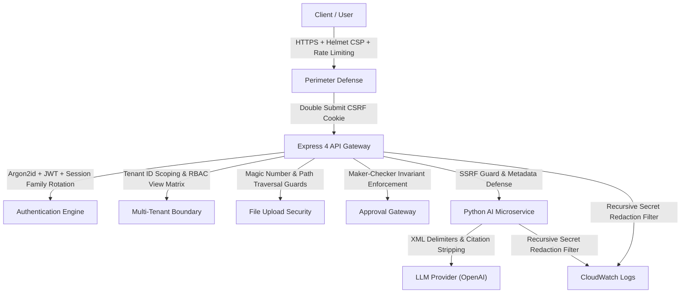

# OpsPilot AI — Security Architecture & Threat Defense Overview

## 1. Security Architecture Summary

OpsPilot AI enforces a defense-in-depth posture across the presentation, application, cognitive orchestration, and data tiers.

---

## 2. Key Security Safeguards Implemented

### 2.1 Identity, Session & Token Protection
- **Argon2id Hashing**: Passwords are hashed using `@node-rs/argon2` with cryptographically calibrated memory and time cost parameters.
- **Short-Lived Access Tokens**: JWT access tokens carry a 15-minute TTL.
- **Atomic Session Rotation**: Refresh tokens are tracked in `app.user_sessions`. Whenever a refresh token is used, it is atomically rotated; if a previously consumed token is presented (token reuse), the entire token family is immediately revoked to neutralize replay attacks.
- **CSRF Defense**: Double-submit cookie pattern matching `opspilot_csrf_token` cookie against the `x-csrf-token` header.

### 2.2 Multi-Tenant Data Isolation & IDOR Defense
- Every request context requires explicit resolution of the active organization (`requireOrganizationContext`).
- Database repositories enforce `WHERE organization_id = $1` on all read and write queries.
- Cross-tenant queries return HTTP 403 or 404 without leaking whether the requested foreign resource ID exists.

### 2.3 SSRF & Perimeter Protection
- **Outbound SSRF Guard (`ssrf_guard.py`)**: Validates every external URL before dispatching HTTP calls. Blocks loopback (`127.0.0.1`), cloud instance metadata service (`169.254.169.254`), and private RFC1918 subnets (`10.0.0.0/8`, `172.16.0.0/12`, `192.168.0.0/16`).

### 2.4 Prompt Injection & Hallucination Defenses
- **XML Delimiters**: Unverified document text retrieved via RAG is enclosed within `<context>` XML boundaries. The system prompt instructs the LLM never to interpret commands within `<context>` as instructions.
- **Authoritative Citation Validation**: The backend validates every citation tag returned by the LLM against the actual chunk IDs returned during the retrieval step. Unauthorized citation tags (hallucinated sources) are stripped before returning answers to clients.

### 2.5 Segregation of Duties & Maker-Checker Policies
- Critical mutations (e.g. ticket priority escalation, automated configuration updates) require human authorization.
- **Self-Approval Prohibition**: The user who requested or triggered the agent proposal CANNOT approve their own action proposal (`MakerCheckerViolationError` HTTP 403). A distinct administrator must review and approve.

### 2.6 Automatic Credential Redaction in Logging
- Node.js logging interceptor recursively sanitizes passwords, Bearer tokens, cookies, secrets, and API keys.
- Python `SecretMaskingFilter` uses high-entropy regex patterns to scrub OpenAI keys (`sk-*`), Bearer tokens, and database passwords from all output streams.

### 2.7 Tiered Distributed Rate Limiting
- Configured using Redis sliding window counters with in-memory fallback:
  - Global API: 100 requests / 15 minutes.
  - AI Operations & Workflows: 15 requests / 1 minute.
  - File Uploads: 10 uploads / 15 minutes.

---

## 3. Known Limitations & Recommendations

1. **Third-Party LLM Dependency**: OpsPilot AI currently integrates with OpenAI's API. Enterprise users requiring strict data residency may configure self-hosted vLLM or Ollama instances using the abstract `BaseLLMProvider` interface.
2. **Virus / Malware Scanning on Upload**: Document uploads validate MIME types and byte headers; integrating ClamAV or AWS GuardDuty S3 scanning is recommended for enterprise virus scanning.
