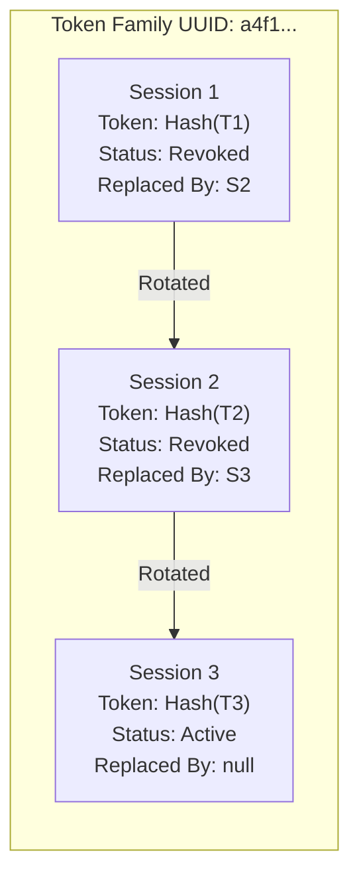
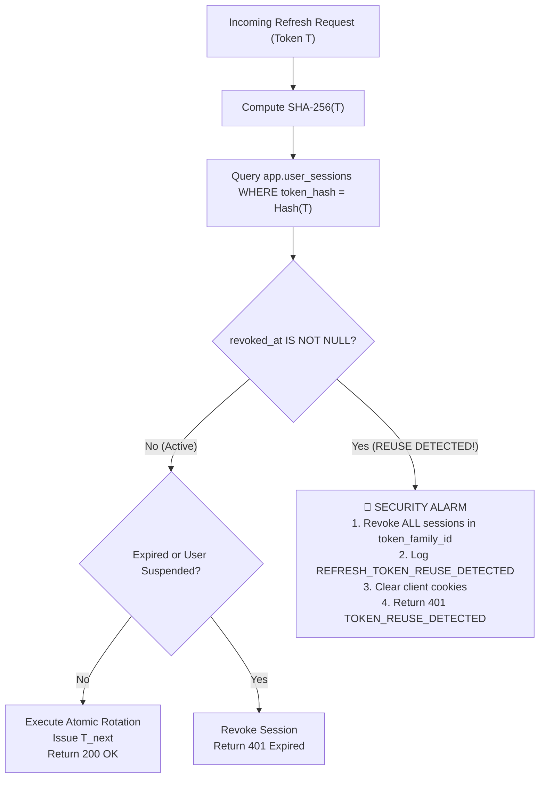
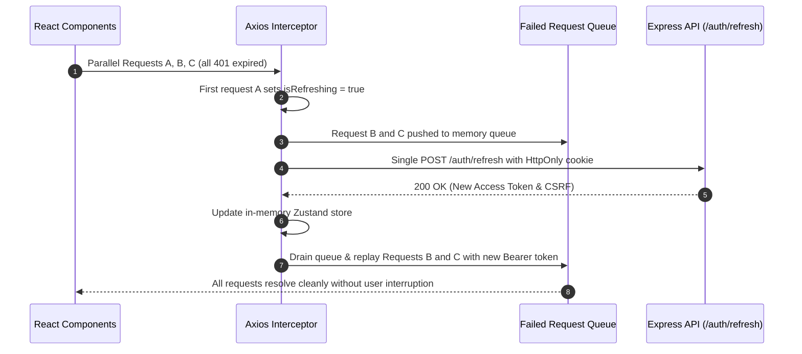

# OpsPilot AI — Session Management & Token Rotation Architecture

## 1. Overview & Threat Model

Session hijacking and credential theft represent critical threats to enterprise AI platforms. If an attacker acquires an authenticated session, they could manipulate operational workflows, access confidential vector embeddings, or trigger autonomous agent tools.

OpsPilot AI addresses these threats through a multi-tier session management engine:

- **Ephemeral Access Tokens** (15-minute lifespan, strictly in-memory).
- **Rotated Refresh Tokens** (7-day lifespan, single-use, stored in HttpOnly cookies).
- **Cryptographic Token Families** (automatic detection and neutralization of replay attacks).
- **Double-Submit CSRF Headers** (cross-site request forgery defense).

---

## 2. Refresh Token Family & Rotation Mechanics

Every time a user logs in, a new **Token Family UUID** is generated. Refresh tokens within this family form a cryptographically linked, append-only chain in `app.user_sessions`:



### Atomic Rotation Transaction

Token rotation is executed inside an explicit PostgreSQL transaction with row-level locking (`SELECT ... FOR UPDATE`):

```sql
BEGIN;

-- 1. Acquire pessimistic lock on old session row
SELECT * FROM app.user_sessions
WHERE id = $1 FOR UPDATE;

-- 2. Verify row has not already been rotated or revoked
-- If revoked_at IS NOT NULL -> REUSE DETECTED!

-- 3. Insert new session record sharing the same token_family_id
INSERT INTO app.user_sessions (user_id, token_hash, token_family_id, user_agent, ip_address, expires_at)
VALUES ($userId, $newTokenHash, $tokenFamilyId, $userAgent, $ipAddress, $expiresAt)
RETURNING *;

-- 4. Mark old session as revoked and record lineage
UPDATE app.user_sessions
SET revoked_at = CURRENT_TIMESTAMP,
    replaced_by_session_id = $newSessionId,
    last_used_at = CURRENT_TIMESTAMP
WHERE id = $oldSessionId;

COMMIT;
```

---

## 3. Token Reuse & Theft Detection Algorithm

If an adversary intercepts a refresh token $T_1$ after a legitimate user has already rotated it to $T_2$, the adversary will attempt to present $T_1$ to `/api/v1/auth/refresh`.

When the API looks up the session for $T_1$:



### Why Token Family Invalidation is Decisive

1. Legitimate user rotates $T_1 \to T_2$.
2. Attacker attempts to use intercepted $T_1$.
3. The server observes that $T_1$ has already been revoked.
4. **Immediate Response**: The server revokes the entire family ($T_1, T_2$). Both the legitimate user and the attacker are immediately logged out.
5. The attacker cannot gain access, and the user is prompted to re-authenticate with their credentials.

---

## 4. Cookie Security Attributes

Refresh tokens and CSRF tokens are delivered via `Set-Cookie` response headers with strict enterprise attributes:

| Cookie Name                  | `HttpOnly` | `Secure`      | `SameSite`       | `Path`         | Purpose                                                                                                                         |
| :--------------------------- | :--------- | :------------ | :--------------- | :------------- | :------------------------------------------------------------------------------------------------------------------------------ |
| **`opspilot_refresh_token`** | **`true`** | `true` (prod) | `Strict` / `Lax` | `/api/v1/auth` | Long-lived session credential. Completely inaccessible to client-side JS (XSS immune). Scoped exclusively to the auth endpoint. |
| **`opspilot_csrf_token`**    | `false`    | `true` (prod) | `Strict` / `Lax` | `/`            | Client-readable anti-CSRF token. Injected into `X-CSRF-Token` header for state-changing requests.                               |

---

## 5. Client Concurrency & Refresh Storm Prevention

In a single-page application (SPA), multiple API requests often fire simultaneously on page load (e.g., fetching user profile, system health, and ticket metrics). If the access token has expired, all outgoing requests would receive HTTP 401 at the same instant.

Without synchronization, the client would fire parallel `/refresh` requests, causing race conditions and triggering false-positive reuse detection.

OpsPilot AI resolves this in `@opspilot/web` through an Axios interceptor concurrency queue:



---

## 6. Storage Strategy Comparison

| Security Dimension     | `localStorage` / `sessionStorage`                                                                          | OpsPilot AI In-Memory + HttpOnly Cookie Pattern                                                                                                        |
| :--------------------- | :--------------------------------------------------------------------------------------------------------- | :----------------------------------------------------------------------------------------------------------------------------------------------------- |
| **XSS Vulnerability**  | **Extreme Risk**: Any injected JS script can read tokens via `localStorage.getItem()` and exfiltrate them. | **Protected**: Refresh tokens are HttpOnly and cannot be read by JS. Access tokens exist only in memory closures.                                      |
| **CSRF Vulnerability** | Low (if custom Authorization header is used).                                                              | **Protected**: Protected by `SameSite=Strict` cookies and `X-CSRF-Token` double-submit header checks.                                                  |
| **Token Lifetime**     | Often set to long duration (hours or days).                                                                | **Strictly partitioned**: Access token = 15 minutes; Refresh token = 7 days with rotation.                                                             |
| **Session Revocation** | Impossible without distributed blacklists until JWT expiry.                                                | **Immediate**: Invalidation in PostgreSQL `app.user_sessions` takes effect on the next 15-minute refresh cycle or immediately on sensitive operations. |
