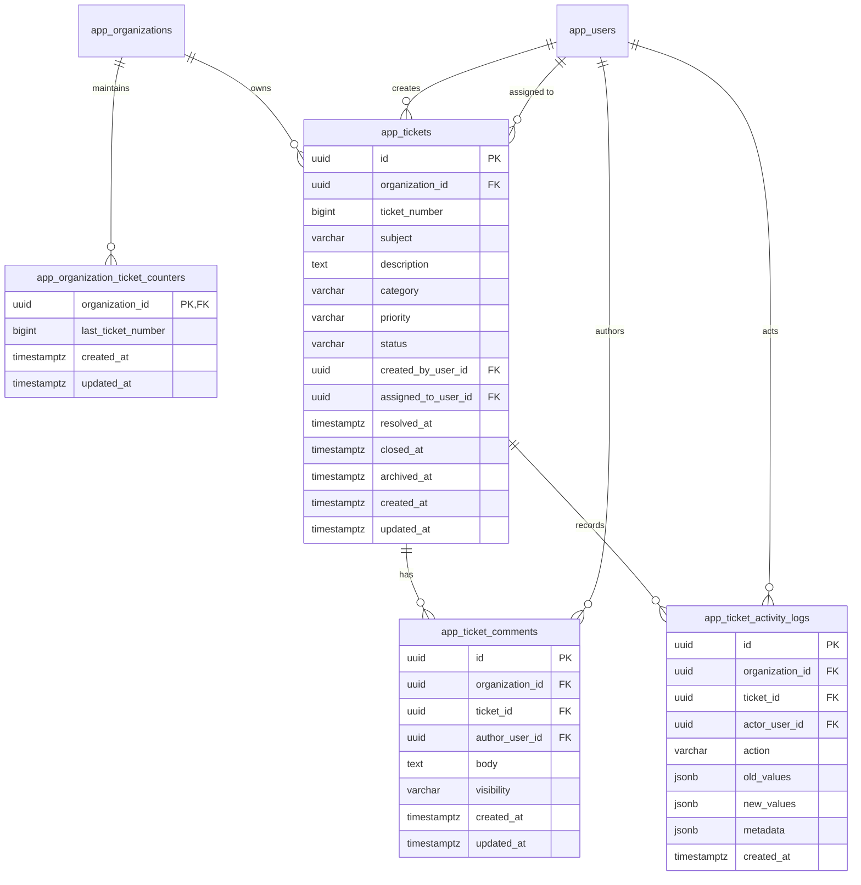
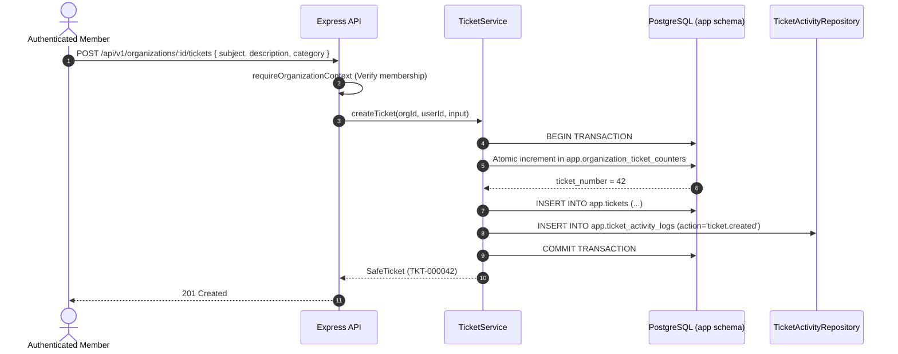

# OpsPilot AI – Support Ticket Management Architecture

This document describes the architectural design, database modeling, concurrency controls, and multi-tenant isolation patterns implemented in Module 05 for **OpsPilot AI**.

---

## 1. Architectural Overview

The Support Ticket Management system forms the operational backbone of OpsPilot AI. It enables organizations to create, track, assign, collaborate on, and resolve customer and internal support issues within strictly isolated multi-tenant boundaries.



---

## 2. Organization-Specific Sequential Ticket Numbering

Enterprise customers require clean, sequential, human-readable ticket numbers (e.g. `TKT-000001`, `TKT-000002`) that start at `1` for each organization independently.

### Concurrency-Safe Sequence Counter

Reading `MAX(ticket_number) + 1` is vulnerable to race conditions under concurrent requests. OpsPilot AI implements an atomic, database-locked UPSERT sequence table:

```sql
INSERT INTO app.organization_ticket_counters (organization_id, last_ticket_number, updated_at)
VALUES ($1, 1, CURRENT_TIMESTAMP)
ON CONFLICT (organization_id)
DO UPDATE SET
  last_ticket_number = app.organization_ticket_counters.last_ticket_number + 1,
  updated_at = CURRENT_TIMESTAMP
RETURNING last_ticket_number;
```

#### Guarantees

1. **Row-Level Lock**: PostgreSQL acquires an exclusive row lock on the organization's counter record during the transaction.
2. **Zero Gaps / Duplicates**: If a ticket creation transaction aborts, the counter increment rolls back cleanly with the transaction.
3. **Internal UUIDs**: Internal primary keys remain non-enumerable UUIDv4 (`app.tickets.id`). The human-readable string (`TKT-000042`) is used exclusively for display and UI indexing.

---

## 3. Transactional Consistency & Atomic State Operations

Critical ticket operations enforce atomic PostgreSQL transaction boundaries combining business mutations and activity logs:



### Rollback Guarantees

- If the activity log insertion fails, the entire transaction rolls back.
- If a ticket status transition fails validation, row locks are released immediately without dirty updates.
- If an assignee is invalid, no database write takes place.

---

## 4. Multi-Tenant Cross-Contamination Defense

1. **Foreign Key Constraints**: All child entities (`app.tickets`, `app.ticket_comments`, `app.ticket_activity_logs`, `app.organization_ticket_counters`) include `organization_id UUID NOT NULL REFERENCES app.organizations(id) ON DELETE CASCADE`.
2. **Parameterized Scoping**: All SQL statements enforce `WHERE organization_id = $1`.
3. **Cross-Tenant Assignment Prevention**: When assigning a ticket, the backend explicitly verifies:
   ```sql
   SELECT id FROM app.organization_members
   WHERE organization_id = $1 AND user_id = $2 AND status = 'active';
   ```
   Users belonging to Org B cannot be assigned to Org A tickets under any circumstance.

---

## 5. Future AI Microservice Integration Points

In future modules (Modules 08–10: AI Microservice, LangGraph Workflows, Autonomous Agentic Triage):

1. **Service Authentication**:
   - AI agents will communicate with the Node.js API using internal service tokens or mTLS.
   - AI agents **cannot** modify ticket status or post internal notes without going through the authorized REST endpoints.
2. **AI Action Logging**:
   - When an AI agent performs automated triage, resolution suggestions, or categorization, it will generate distinct activity log events:
     `ticket.ai_triaged`, `ticket.ai_suggested_response`, `ticket.ai_classified`.
   - The `actor_user_id` will reference the system AI bot user or remain null with `metadata.actor = 'ai_agent'`.
3. **Vector Database Isolation**:
   - Vector embeddings of ticket descriptions and public comments stored in schema `ai` will include `organization_id UUID NOT NULL` to prevent cross-tenant knowledge leaks during RAG searches.
