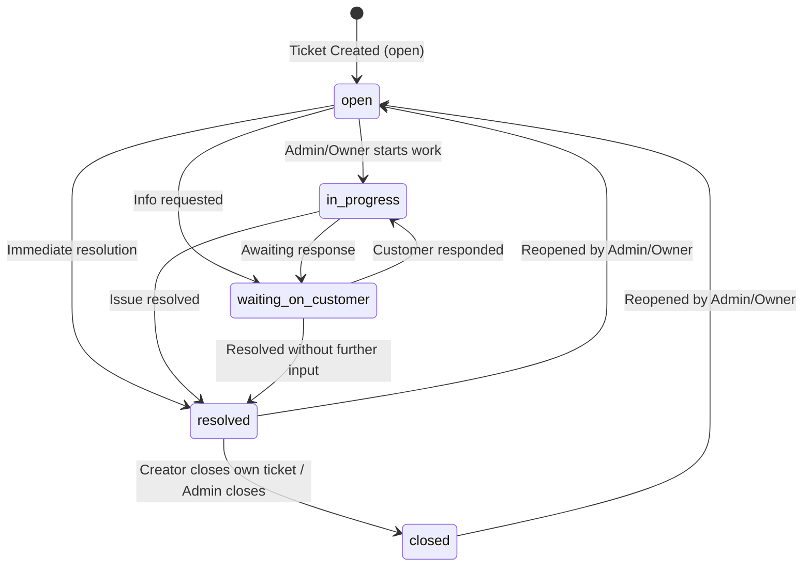

# OpsPilot AI – Ticket Workflow & State Machine

This document defines the ticket lifecycle, status state machine, authorized transition matrices, and timestamp rules implemented in Module 05 for **OpsPilot AI**.

---

## 1. Ticket Lifecycle State Machine

OpsPilot AI support tickets transition through 5 strictly defined lifecycle states:



---

## 2. Transition Matrix & Authorization Rules

| Origin Status         | Target Status         | Allowed? | Authorized Actors                    | Generated Action Event  |
| --------------------- | --------------------- | :------: | ------------------------------------ | ----------------------- |
| `open`                | `in_progress`         |    ✅    | `owner`, `admin`                     | `ticket.status_changed` |
| `open`                | `waiting_on_customer` |    ✅    | `owner`, `admin`                     | `ticket.status_changed` |
| `open`                | `resolved`            |    ✅    | `owner`, `admin`                     | `ticket.resolved`       |
| `open`                | `closed`              |    ❌    | _Forbidden direct transition_        | N/A                     |
| `in_progress`         | `waiting_on_customer` |    ✅    | `owner`, `admin`                     | `ticket.status_changed` |
| `in_progress`         | `resolved`            |    ✅    | `owner`, `admin`                     | `ticket.resolved`       |
| `in_progress`         | `open`                |    ❌    | _Forbidden regression_               | N/A                     |
| `in_progress`         | `closed`              |    ❌    | _Must resolve first_                 | N/A                     |
| `waiting_on_customer` | `in_progress`         |    ✅    | `owner`, `admin`                     | `ticket.status_changed` |
| `waiting_on_customer` | `resolved`            |    ✅    | `owner`, `admin`                     | `ticket.resolved`       |
| `waiting_on_customer` | `open`                |    ❌    | _Forbidden regression_               | N/A                     |
| `resolved`            | `closed`              |    ✅    | `owner`, `admin`, **Ticket Creator** | `ticket.closed`         |
| `resolved`            | `open`                |    ✅    | `owner`, `admin` (_Reopen_)          | `ticket.reopened`       |
| `closed`              | `open`                |    ✅    | `owner`, `admin` (_Reopen_)          | `ticket.reopened`       |
| `closed`              | `in_progress`         |    ❌    | _Must reopen first_                  | N/A                     |
| `closed`              | `resolved`            |    ❌    | _Must reopen first_                  | N/A                     |

---

## 3. Timestamp Invariants & Reopen Behavior

Lifecycle timestamps maintain strict integrity during status transitions:

1. **Entering `resolved`**:
   - `resolved_at = CURRENT_TIMESTAMP`
   - `closed_at = NULL`
2. **Entering `closed`**:
   - `closed_at = CURRENT_TIMESTAMP`
   - `resolved_at` is preserved (or set if closing directly from resolved).
3. **Reopening (`open` from `resolved` or `closed`)**:
   - `resolved_at = NULL` (cleared)
   - `closed_at = NULL` (cleared)
   - Generates `ticket.reopened` activity log event.
4. **Moving to `in_progress` or `waiting_on_customer`**:
   - `resolved_at = NULL`
   - `closed_at = NULL`

---

## 4. Centralized Workflow Service Architecture

All status transitions are routed exclusively through `TicketWorkflowService.transitionStatus()` inside a row-locked transaction:

```ts
const ticket = await ticketRepo.findByIdForUpdate(orgId, ticketId, client);

// 1. Check topological validity
if (!isValidTransition(ticket.status, targetStatus)) {
  throw new Error(
    `INVALID_STATUS_TRANSITION: Cannot transition from ${ticket.status} to ${targetStatus}`
  );
}

// 2. Enforce role-based permission
if (!isAdminOrOwner) {
  if (
    ticket.status === 'resolved' &&
    targetStatus === 'closed' &&
    ticket.created_by_user_id === actorUserId
  ) {
    // Permitted: Creator closing their own resolved ticket
  } else {
    throw new Error('FORBIDDEN_STATUS_TRANSITION: Insufficient permissions');
  }
}
```

Direct SQL status updates or bypasses through generic PATCH endpoints are forbidden.
