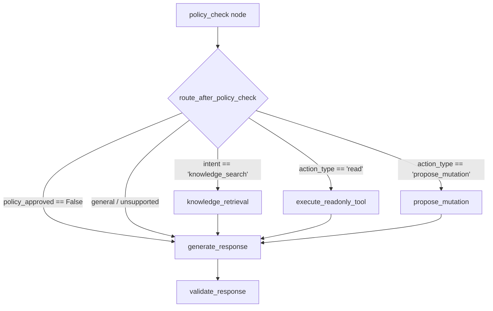

# Workflow Conditional Routing & Intent Classification

## Overview

In OpsPilot AI, dynamic branch routing in LangGraph is managed by `route_after_policy_check` in `apps/ai-service/app/agents/routing/workflow_router.py`.

Unlike unrestricted agent architectures where the model generates arbitrary function calls or jumps across steps without constraint, OpsPilot implements **strictly allowlisted conditional routing** based on structured intent classification and policy enforcement.



---

## Intent Classification Taxonomy

Every user prompt is categorized by `classify_intent` into one of 7 bounded intents:

| Intent Category         | Primary Action             | Required Scope   | Routing Target          |
| ----------------------- | -------------------------- | ---------------- | ----------------------- |
| `knowledge_search`      | Hybrid RAG retrieval       | `knowledge:read` | `knowledge_retrieval`   |
| `ticket_creation`       | Propose ticket creation    | `tickets:write`  | `propose_mutation`      |
| `ticket_update`         | Propose ticket update      | `tickets:write`  | `propose_mutation`      |
| `ticket_lookup`         | Query single ticket        | `tickets:read`   | `execute_readonly_tool` |
| `user_lookup`           | Query organization members | `users:read`     | `execute_readonly_tool` |
| `support_history_query` | Query ticket history       | `tickets:read`   | `execute_readonly_tool` |
| `general_question`      | Direct model completion    | None             | `generate_response`     |
| `unsupported_request`   | Inform user of boundary    | None             | `generate_response`     |

---

## Routing Invariant & Policy Verification

The routing logic strictly evaluates policy outcomes before selecting downstream nodes:

```python
def route_after_policy_check(state: OpsPilotWorkflowState) -> str:
    # 1. If policy verification failed, immediately route to response generation
    if not state.get("policy_approved", True):
        return "generate_response"

    plan = state.get("plan") or {}
    intent = state.get("intent")
    action_type = plan.get("action_type", "none")

    # 2. Knowledge search branch
    if intent == "knowledge_search":
        return "knowledge_retrieval"

    # 3. Read-only tool execution branch
    if action_type == "read" and plan.get("selected_tool"):
        return "execute_readonly_tool"

    # 4. State-mutation proposal branch (strictly proposal-only)
    if action_type == "propose_mutation" and plan.get("selected_tool"):
        return "propose_mutation"

    # 5. Fallback: direct response generation for general questions or clarifications
    return "generate_response"
```

### Safety Guarantee

Because conditional branches are strictly limited to declared node names (`knowledge_retrieval`, `execute_readonly_tool`, `propose_mutation`, `generate_response`), the graph compiler guarantees that no arbitrary or unmapped transitions can occur during workflow execution.
