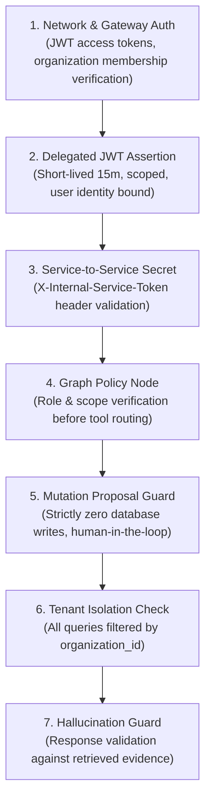

# Workflow Security & Safeguards

## Overview

Enterprise AI agents pose critical security challenges when authorized to discover tools, search private corporate knowledge, and interact with production workflows. OpsPilot AI implements a **Defense-in-Depth Security Framework** for workflow execution.

---

## Defense-in-Depth Layers

---

## Security Invariants

### 1. Zero Direct Mutations Without Approval

No tool executed within the workflow engine may directly write, update, or delete production data.

- Mutation tools (`create_support_ticket`, `update_support_ticket`) generate an action proposal.
- The proposal records:
  - `proposal_id`: cryptographically unique UUID.
  - `tool_name`: requested mutation tool.
  - `proposed_action`: sanitized arguments.
  - `risk_level`: classification (`low`, `medium`, `high`, `critical`).
  - `requires_approval`: set to `True`.
  - `status`: set to `awaiting_approval`.
- Execution halts after generating the proposal. The user is prompted to review and approve the action.

### 2. Delegated Authorization Assertion

- The agent does not inherit root system privileges.
- Every external invocation carries a short-lived (15-minute) delegated JWT issued by the Node.js API authority.
- The delegation token specifies:
  - `sub`: The ID of the authenticated user who initiated the workflow.
  - `orgId`: The organization context.
  - `scopes`: Permitted tool operations (e.g., `tickets:read`, `tickets:write`).
- The internal tool gateway validates this token before returning any organization data.

### 3. Context & Credential Isolation

- Authorization tokens and secrets are held in `WorkflowContext` in runtime memory.
- `WorkflowContext` is never placed into `OpsPilotWorkflowState`.
- Checkpointer tables in PostgreSQL (`ai.agent_checkpoints`) never receive authorization tokens, credentials, or session keys.

### 4. Grounded Evidence Verification

- Responses generated from knowledge base retrieval are inspected by `validate_response`.
- Any citation IDs synthesized or hallucinated by the LLM that do not map to chunks actually retrieved by the RAG engine are stripped before final output.
- If no matching documents are found, `insufficient_evidence` is set to `True`, preventing confabulation.
